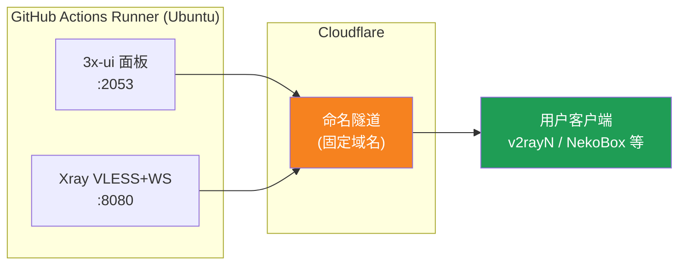
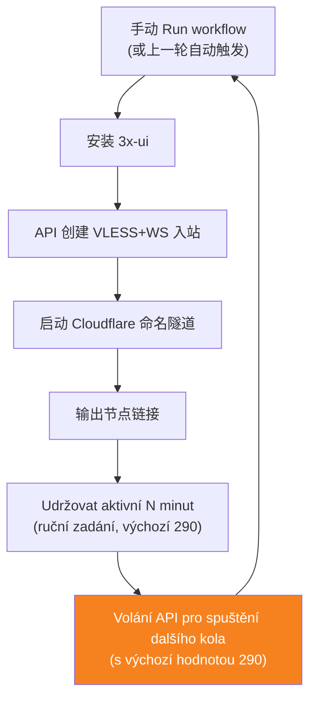
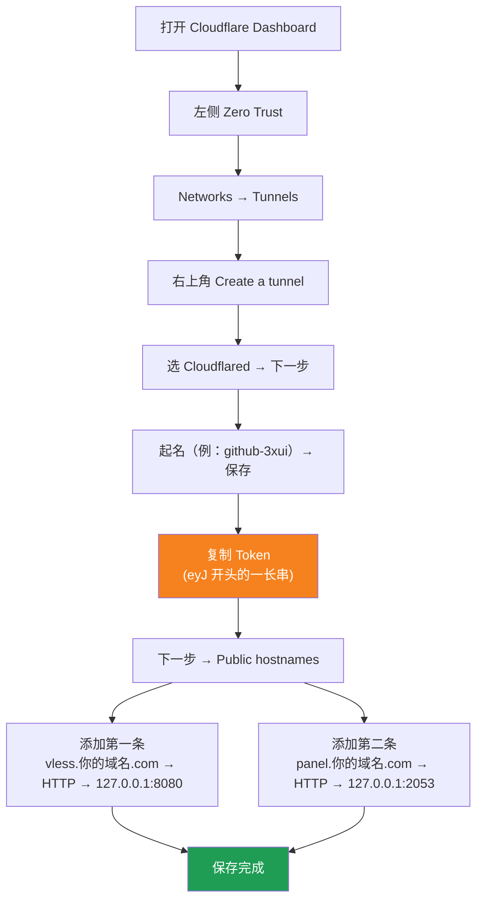

[简体中文](README.md) | [English](README.en.md) | [Русский](README.ru.md) | [日本語](README.ja.md) | [한국어](README.ko.md) | [Español](README.es.md) | [العربية](README.ar.md) | [Čeština](README.cs.md) | [Dansk](README.da.md) | [Deutsch](README.de.md) | [Esperanto](README.eo.md) | [فارسی](README.fa.md) | [Suomi](README.fi.md) | [Français](README.fr.md) | [Ελληνικά](README.gr.md) | [Magyar](README.hu.md) | [Bahasa Indonesia](README.id.md) | [Italiano](README.it.md) | [മലയാളം](README.ml.md) | [Nederlands](README.nl.md) | [Norsk](README.no.md) | [Polski](README.pl.md) | [Português](README.ptbr.md) | [Română](README.ro.md) | [Türkçe](README.tr.md) | [Українська](README.ua.md) | [Tiếng Việt](README.vn.md)

# ☁️ cloud-3xui — Bezplatný VLESS uzel na GitHubu

Automaticky nasadí panel 3x-ui + VLESS uzel na bezplatných serverech GitHub Actions s pevnou doménou a automatickým obnovením při výpadku.

## Diagram architektury



## Proces automatického prodloužení



## Automatické prodloužení

- **Délku udržení určujete vy**: při kliknutí na Run workflow ručně vyplňte `run_minutes`, poběží tolik minut, kolik zadáte; pokud pole necháte prázdné, použije se výchozí hodnota 290
- **Automatické spuštění používá výchozí hodnotu**: na konci každého kola se volá API pro spuštění dalšího kola, volání API nenese žádné parametry, takže každé automaticky prodloužené kolo trvá 290 minut
- Pro rychlý test vyplňte `5`, pro běžné použití nechte prázdné a použije se výchozí 290
- Doména i UUID jsou pevné, konfigurace klienta stačí nastavit jednou a platí trvale
- Pro zastavení přejděte do Actions a klikněte na Cancel, po zrušení se automaticky nerestartuje

## Pevné adresy

| Účel | Adresa |
|------|------|
| Uzel | `vless.my-github.ccwu.cc:443` (VLESS + WebSocket + TLS) |
| Panel | `https://panel.my-github.ccwu.cc/panel` (uživatelské jméno `admin`) |

> ⚠️ Výše uvedené domény jsou jen příklady, nahraďte je vlastní doménou.

## Podrobný návod k nastavení

### Krok 1: Vytvoření pojmenovaného tunelu v Cloudflare


Oficiální stránky Cloudflare: https://www.cloudflare-cn.com (Čína) / https://www.cloudflare.com (mezinárodní)
Řídicí panel: https://dash.cloudflare.com



1. Otevřete [Cloudflare Dashboard](https://dash.cloudflare.com), v levém menu přejděte na **Zero Trust**
2. Vlevo **Networks** → **Tunnels**, vpravo nahoře klikněte na **Create a tunnel**
3. Zvolte typ **Cloudflared** a pokračujte dalším krokem
4. Pojmenujte tunel (např. `github-3xui`) a uložte
5. Stránka zobrazí instalační příkaz ve tvaru:
   ```
   cloudflared.exe service install eyJhIjoiYzEyNGI2...
   ```
   Zkopírujte dlouhý řetězec začínající na `eyJ` — to je váš **Tunnel Token**, dobře si ho uložte
6. Klikněte na další krok do sekce **Public hostnames** (zveřejněné trasy aplikací) a klikněte na **Add a public hostname**, přidejte dva záznamy:

   **První (uzel):**
   - Subdomain (subdoména): `vless`
   - Domain (doména): vyberte svou doménu
   - Service Type (typ služby): `HTTP`
   - URL: `127.0.0.1:8080`

   **Druhý (panel):**
   - Subdomain (subdoména): `panel`
   - Domain (doména): vyberte svou doménu
   - Service Type (typ služby): `HTTP`
   - URL: `127.0.0.1:2053`

7. Uložte. Cloudflare automaticky vytvoří DNS záznamy, není třeba je přidávat ručně.

### Krok 2: Vygenerování UUID

1. Otevřete https://1024tools.com/uuid/
2. Zkopírujte vygenerované UUID (ve tvaru `cbfc229f-9d34-4fef-9990-8baa82a7327b`)
3. **Toto UUID si dobře poznamenejte**, v logu workflow se nezobrazí v otevřené podobě a budete ho potřebovat při každém skládání odkazu na uzel

### Krok 3: Přidání Secrets na GitHubu

1. Otevřete tento repozitář a klikněte na záložku **Settings**
2. Vlevo **Secrets and variables** → **Actions**
3. Vpravo nahoře klikněte na **New repository secret** a postupně přidejte tři:

   | Name | Secret (hodnota) | Popis |
   |------|-------------|------|
   | `CF_TUNNEL_TOKEN` | Tunnel Token zkopírovaný v kroku 1 | Přihlašovací údaje tunelu Cloudflare |
   | `PANEL_PASSWORD` | Vámi nastavené heslo panelu | Přihlašovací heslo panelu 3x-ui |
   | `VLESS_UUID` | UUID vygenerované v kroku 2 | UUID uzlu, nemění se |

### Krok 4: Spuštění workflow

1. Klikněte na záložku **Actions** v horní části repozitáře
2. Vlevo vyberte **3x-ui VLESS Node**
3. Vpravo klikněte na tlačítko **Run workflow**
4. Ve vyskakovacím formuláři:
   - **Panel password**: nechte prázdné (automaticky se použije `PANEL_PASSWORD` secret)
     Heslo panelu (prázdné = použije se PANEL_PASSWORD secret)
   - **Run duration**: výchozí `290` (minut), při prvním testu můžete zadat `5` pro rychlé ověření; pro běžné použití nechte prázdné
     Doba běhu (v minutách, výchozí 290, max. 340)
5. Kliknutím na zelené **Run workflow** spustíte běh

### Krok 5: Získání odkazu na uzel

1. Počkejte asi 2–3 minuty, klikněte na běžící úlohu a otevřete detail
2. Rozbalte krok **Start named Cloudflare tunnel** a podívejte se na výstup logu:
   ```
   ==================================================
     面板 Panel: https://panel.my-github.ccwu.cc/panel  (admin / 你的密码 your password)

     VLESS 节点 node:
     vless://YOUR_UUID@vless.my-github.ccwu.cc:443?encryption=none&security=tls&sni=vless.my-github.ccwu.cc&type=ws&path=%2Fws#GitHub-3xui

     把 YOUR_UUID 换成你在 VLESS_UUID secret 里填的 UUID
     Replace YOUR_UUID with the UUID from your VLESS_UUID secret
   ==================================================
   ```
3. Zkopírujte odkaz `vless://` a nahraďte `YOUR_UUID` svým UUID
4. Vložte ho do klientů v2rayN / v2rayNG / Streisand / NekoBox apod. a můžete používat

### Krok 6: Ověření automatického prodloužení (volitelné)

1. Při prvním běhu nastavte dobu na `5` minut
2. Po 5 minutách zkontrolujte log posledního kroku **Trigger next run**, měl by se objevit:
   ```
   HTTP 204
   已触发下一次运行 Next run triggered
   ```
3. Vraťte se na seznam Actions, měl by se objevit nový automaticky spuštěný běh
4. Po ověření spusťte znovu a vraťte dobu na `290` pro běžné používání

## Popis kroků workflow

| Krok | Česky | English | Popis |
|------|------|---------|------|
| Install 3x-ui | Instalace 3x-ui | Install 3x-ui | Nainstaluje panel oficiálním skriptem bez interakce |
| Create VLESS+WS inbound via API | Vytvoření příchozího VLESS+WS přes API | Create VLESS+WS inbound via API | Přihlásí se přes API Token a automaticky vytvoří příchozí |
| Start named Cloudflare tunnel | Spuštění pojmenovaného tunelu Cloudflare | Start named Cloudflare tunnel | Připojí tunel s pevnou doménou pomocí Tokenu |
| Keep alive | Udržení běhu | Keep alive | Uspí se na zadaný počet minut a sleduje stav služeb |
| Trigger next run | Spuštění dalšího běhu | Trigger next run | Zavolá API a automaticky nastartuje další kolo |

## Časté dotazy

**Q: V logu se UUID v odkazu na uzel zobrazuje jako `***`?**
A: To je ochranný mechanismus secretů GitHubu. Nahraďte `YOUR_UUID` UUID, které jste zadali do `VLESS_UUID` secret.

**Q: Test klienta selže (-1)?**
A: Zkontrolujte tři věci: ① zda je UUID nahrazeno správně; ② zda je verze klienta dostatečně nová (v2rayN 7.x+); ③ zda je tunel Cloudflare správně připojen (podívejte se do logu).

**Q: Automatický restart se nespustil?**
A: Podívejte se na log kroku **Trigger next run**. Pokud se zobrazí jiný HTTP stavový kód než 204, zkontrolujte nastavení oprávnění Actions v repozitáři.

**Q: Je normální, že se každých 5 hodin na pár minut přeruší spojení?**
A: Ano, je to normální. Od konce předchozího kola do připojení tunelu v dalším kole to trvá asi 3–5 minut, klient se automaticky znovu připojí.

**Q: Chci zastavit automatické prodloužení?**
A: Na stránce Actions zrušte (Cancel) aktuální běh a automaticky se už nic nespustí.

## Poznámky

- **Rychlost**: provoz jde přes Cloudflare → datacentra GitHubu (USA/Evropa), vhodné pouze pro dočasné/lehké použití
- **Krátký výpadek**: při automatickém restartu každých 5 hodin vypadne spojení asi na 3–5 minut (start nového stroje, instalace 3x-ui, opětovné připojení tunelu), klient se automaticky znovu připojí
- **Podmínky**: běh proxy na GitHub Actions může porušovat ToS a vést k zablokování účtu, zvažte sami
- **Bezpečnost**: nezveřejňujte `CF_TUNNEL_TOKEN` / `PANEL_PASSWORD` / `VLESS_UUID`
