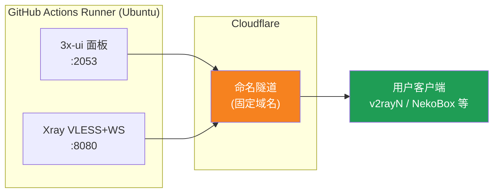
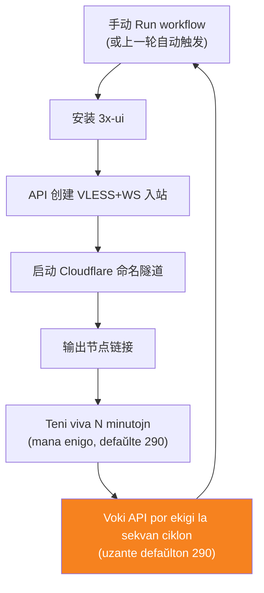
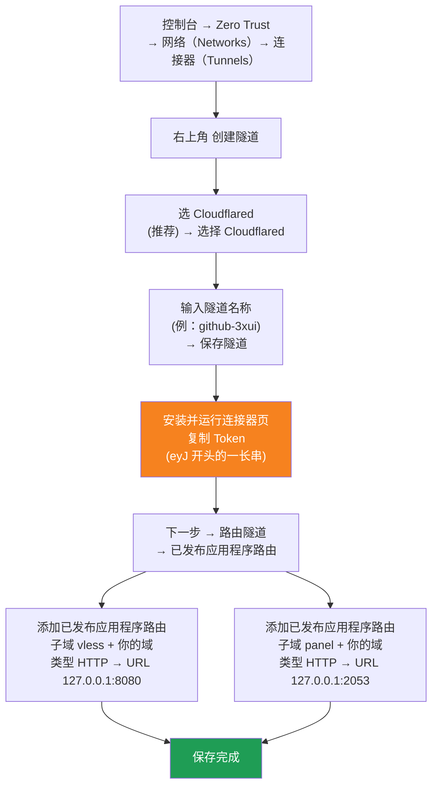

[简体中文](README.md) | [English](README.en.md) | [Русский](README.ru.md) | [日本語](README.ja.md) | [한국어](README.ko.md) | [Español](README.es.md) | [العربية](README.ar.md) | [Čeština](README.cs.md) | [Dansk](README.da.md) | [Deutsch](README.de.md) | [Esperanto](README.eo.md) | [فارسی](README.fa.md) | [Suomi](README.fi.md) | [Français](README.fr.md) | [Ελληνικά](README.gr.md) | [Magyar](README.hu.md) | [Bahasa Indonesia](README.id.md) | [Italiano](README.it.md) | [മലയാളം](README.ml.md) | [Nederlands](README.nl.md) | [Norsk](README.no.md) | [Polski](README.pl.md) | [Português](README.ptbr.md) | [Română](README.ro.md) | [Türkçe](README.tr.md) | [Українська](README.ua.md) | [Tiếng Việt](README.vn.md)

# ☁️ cloud-3xui — Senpaga VLESS-nodo sur GitHub

Aŭtomate starigas panelon 3x-ui + VLESS-nodon sur la senpagaj serviloj de GitHub Actions, kun fiksa domajno kaj aŭtomata renovigo kiam la konekto ĉesiĝas.

## Arkitektura diagramo



## Procezo de aŭtomata renovigo



## Aŭtomata renovigo

- **La daŭron vi decidas**: kiam vi alklakas Run workflow, plenigu mane `run_minutes` – ĝi rulos tiom da minutoj, kiom vi enigos; se vi lasos ĝin malplena, uziĝos la defaŭlto 290
- **Aŭtomata ekigo uzas la defaŭlton**: je la fino de ĉiu ciklo la API estas vokata por lanĉi la sekvan ciklon, kaj la API-voko portas neniujn parametrojn, do ĉiu aŭtomate renovigata ciklo daŭras 290 minutojn
- Por rapida testo tajpu `5`; por ĉiutaga uzado lasu ĝin malplena kaj uzu la defaŭlton 290
- La domajno kaj UUID estas fiksaj, do la klienta agordo post unufoja agordo validas por ĉiam
- Por haltigi, iru al Actions kaj alklaku Cancel – post nuligo ĝi ne restartiĝos aŭtomate

## Fiksaj adresoj

| Celo | Adreso |
|------|------|
| Nodo | `vless.my-github.ccwu.cc:443` (VLESS + WebSocket + TLS) |
| Panelo | `https://panel.my-github.ccwu.cc/panel` (uzantnomo `admin`) |

> ⚠️ La supraj domajnoj estas ekzemploj, anstataŭigu ilin per via propra domajno.

## Detalaj agordaj paŝoj

### Senpaga domajno (ĉu vi ne havas domajnon? komencu ĉi tie)

Ĉu vi ne havas propran domajnon? Petu senpagan ĉe https://my.dnshe.com/ (ekz. `.ccwu.cc`, valida dum 10 jaroj), kaj poste delegu la NS-registrojn de la domajno al Cloudflare.

### Paŝo 1: Krei nomitan tunelon en Cloudflare


Oficiala retejo de Cloudflare: https://www.cloudflare-cn.com (Ĉinujo) / https://www.cloudflare.com (internacia)
Stirpanelo: https://dash.cloudflare.com



Detalaj paŝoj:

1. Malfermu la [stirpanelon de Cloudflare](https://dash.cloudflare.com) kaj iru al **Zero Trust** → **Retoj (Networks)** → **Konektiloj (Tunnels)** en la maldekstra menuo
2. Alklaku **Create a tunnel** supre dekstre
3. **Elektu la tunelan tipon**: elektu **Cloudflared** (rekomendata) kaj alklaku **Select Cloudflared**
4. **Nomu la tunelon**: entajpu nomon (ekz. `github-3xui`) kaj alklaku **Save tunnel**
5. **Instalu kaj rulu la konektilon**: la paĝo montras instalan komandon — kopiu la longan **ĵetonon** komenciĝantan per `eyJ` kaj konservu ĝin (vi uzos ĝin kiel GitHub Secret). Loka instalo **ne** necesas; simple daŭrigu
6. **Direktu la tunelon**: iru al la langeto **Public hostnames**, alklaku **Add a public hostname** kaj aldonu du erojn:

   **Unua (nodo):**
   - Subdomajno: `vless`
   - Domajno: elektu vian domajnon
   - Tipo: `HTTP`
   - URL: `127.0.0.1:8080`

   **Dua (panelo):**
   - Subdomajno: `panel`
   - Domajno: elektu vian domajnon
   - Tipo: `HTTP`
   - URL: `127.0.0.1:2053`
7. Konservu. Cloudflare kreas la DNS-registraĵojn aŭtomate. Stato **Healthy** en la listo de Tunnels signifas sukcesan agordon.


### Paŝo 2: Generi UUID

1. Malfermu https://1024tools.com/uuid/
2. Kopiu la generitan UUID (en la formo `cbfc229f-9d34-4fef-9990-8baa82a7327b`)
3. **Nepre notu ĉi tiun UUID**, ĝi ne aperos en klara teksto en la protokolo de la laborfluo, kaj vi bezonos ĝin ĉiufoje kiam vi kunmetos la nodan ligilon

### Paŝo 3: Aldoni Secrets en GitHub

1. Iru al ĉi tiu deponejo kaj alklaku la langeton **Settings**
2. Maldekstre **Secrets and variables** → **Actions**
3. Supre dekstre alklaku **New repository secret** kaj aldonu la tri sinsekve:

   | Name | Secret (valoro) | Priskribo |
   |------|-------------|------|
   | `CF_TUNNEL_TOKEN` | La Tunnel Token kopiita en paŝo 1 | Aŭtentigilo de la Cloudflare-tunelo |
   | `PANEL_PASSWORD` | La panela pasvorto kiun vi difinis | Ensaluta pasvorto de la 3x-ui panelo |
   | `VLESS_UUID` | La UUID generita en paŝo 2 | UUID de la nodo, restas senŝanĝa |

### Paŝo 4: Ruli la laborfluon

1. Alklaku la langeton **Actions** supre de la deponejo
2. Maldekstre elektu **3x-ui VLESS Node**
3. Dekstre alklaku la butonon **Run workflow**
4. En la aperanta formularo:
   - **Panel password**: lasu malplena (aŭtomate uzos la `PANEL_PASSWORD` sekreton)
     Panela pasvorto (malplena = uzas la PANEL_PASSWORD sekreton)
   - **Run duration**: defaŭlte `290` (minutoj), por unua testo vi povas tajpi `5` por rapida kontrolo; por ĉiutaga uzado lasu malplena
     Rultempo (minutoj, defaŭlte 290, maksimume 340)
5. Alklaku la verdan **Run workflow** por komenci

### Paŝo 5: Akiri la nodan ligilon

1. Atendu ĉirkaŭ 2-3 minutojn, alklaku la kurantan taskon por malfermi la detalan paĝon
2. Malfaldu la paŝon **Start named Cloudflare tunnel** kaj rigardu la protokolon:
   ```
   ==================================================
     面板 Panel: https://panel.my-github.ccwu.cc/panel  (admin / 你的密码 your password)

     VLESS 节点 node:
     vless://YOUR_UUID@vless.my-github.ccwu.cc:443?encryption=none&security=tls&sni=vless.my-github.ccwu.cc&type=ws&path=%2Fws#GitHub-3xui

     把 YOUR_UUID 换成你在 VLESS_UUID secret 里填的 UUID
     Replace YOUR_UUID with the UUID from your VLESS_UUID secret
   ==================================================
   ```
3. Kopiu la ligilon `vless://` kaj anstataŭigu `YOUR_UUID` per via UUID
4. Algluu ĝin en v2rayN / v2rayNG / Streisand / NekoBox ktp. por uzi

### Paŝo 6: Kontroli la aŭtomatan renovigon (nedeviga)

1. Por la unua rulo agordu la daŭron al `5` minutoj
2. Post 5 minutoj rigardu la protokolon de la lasta paŝo **Trigger next run**, ĝi devus montri:
   ```
   HTTP 204
   已触发下一次运行 Next run triggered
   ```
3. Reiru al la Actions-listo, devus aperi nova aŭtomate ekigita rulo
4. Post konfirmo, rulu denove kaj reŝanĝu la daŭron al `290` por normala uzado

## Priskribo de laborfluaj paŝoj

| Paŝo | Esperante | English | Priskribo |
|------|------|---------|------|
| Install 3x-ui | Instali 3x-ui | Install 3x-ui | Instalas la panelon neinterage per la oficiala skripto |
| Create VLESS+WS inbound via API | Krei VLESS+WS eniron per API | Create VLESS+WS inbound via API | Ensalutas per API-ĵetono kaj aŭtomate kreas la eniron |
| Start named Cloudflare tunnel | Lanĉi nomitan Cloudflare-tunelon | Start named Cloudflare tunnel | Konektas la tunelon kun fiksa domajno per ĵetono |
| Keep alive | Teni viva | Keep alive | Dormas la specifitan nombron da minutoj kaj kontrolas la servan staton |
| Trigger next run | Ekigi la sekvan rulon | Trigger next run | Vokas la API kaj aŭtomate lanĉas la sekvan ciklon |

## Oftaj demandoj

**Q: La UUID en la noda ligilo aperas kiel `***` en la protokolo?**
A: Tio estas la sekreta protekta mekanismo de GitHub. Anstataŭigu `YOUR_UUID` per la UUID kiun vi metis en la `VLESS_UUID` sekreton.

**Q: La klienta testo malsukcesas (-1)?**
A: Kontrolu tri aferojn: ① ĉu la UUID estas ĝuste anstataŭigita; ② ĉu la klienta versio estas sufiĉe nova (v2rayN 7.x+); ③ ĉu la Cloudflare-tunelo estas ĝuste konektita (rigardu la protokolon).

**Q: La aŭtomata restartigo ne ekis?**
A: Rigardu la protokolon de la paŝo **Trigger next run**. Se aperas HTTP-statokodo alia ol 204, kontrolu la Actions-permesajn agordojn de la deponejo.

**Q: Ĉu estas normale ke la konekto ĉesiĝas kelkajn minutojn ĉiujn 5 horojn?**
A: Jes, estas normale. De la fino de la antaŭa ciklo ĝis la tunela konekto en la sekva ciklo necesas ĉirkaŭ 3-5 minutoj, la kliento aŭtomate rekonektiĝos.

**Q: Ĉu vi volas haltigi la aŭtomatan renovigon?**
A: Iru al la Actions-paĝo kaj nuligu (Cancel) la aktualan rulon, kaj ĝi ne plu ekigos aŭtomate.

## Atentigoj

- **Rapido**: la trafiko iras per Cloudflare → GitHub-servilejoj (Usono/Eŭropo), taŭga nur por provizora/malpeza uzado
- **Mallonga interrompo**: ĉe la aŭtomata restartigo ĉiujn 5 horojn la konekto ĉesiĝas ĉirkaŭ 3-5 minutojn (nova maŝino startas, 3x-ui instaliĝas, tunelo rekonektiĝas), la kliento aŭtomate rekonektiĝos
- **Konformeco**: ruli prokurilon sur GitHub Actions povas malobservi la ToS kaj konduki al konta suspendo, taksu mem
- **Sekureco**: ne publikigu `CF_TUNNEL_TOKEN` / `PANEL_PASSWORD` / `VLESS_UUID`
