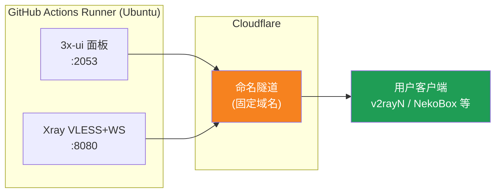
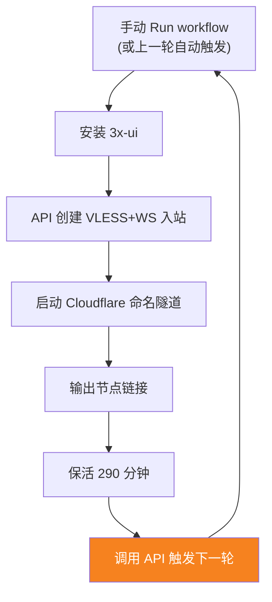

[简体中文](README.md) | [English](README.en.md) | [Русский](README.ru.md) | [日本語](README.ja.md) | [한국어](README.ko.md) | [Español](README.es.md) | [العربية](README.ar.md) | [Čeština](README.cs.md) | [Dansk](README.da.md) | [Deutsch](README.de.md) | [Esperanto](README.eo.md) | [فارسی](README.fa.md) | [Suomi](README.fi.md) | [Français](README.fr.md) | [Ελληνικά](README.gr.md) | [Magyar](README.hu.md) | [Bahasa Indonesia](README.id.md) | [Italiano](README.it.md) | [മലയാളം](README.ml.md) | [Nederlands](README.nl.md) | [Norsk](README.no.md) | [Polski](README.pl.md) | [Português](README.ptbr.md) | [Română](README.ro.md) | [Türkçe](README.tr.md) | [Українська](README.ua.md) | [Tiếng Việt](README.vn.md)

# ☁️ cloud-3xui — Nodo VLESS gratuito en GitHub

Construye automáticamente un panel 3x-ui + nodo VLESS en los servidores gratuitos de GitHub Actions, con dominio fijo y reconexión automática.

## Arquitectura



## Flujo de reconexión automática



## Direcciones fijas

| Uso | Dirección |
|-----|-----------|
| Nodo | `vless.my-github.ccwu.cc:443` (VLESS + WebSocket + TLS) |
| Panel | `https://panel.my-github.ccwu.cc/panel` (usuario `admin`) |

> ⚠️ Los dominios anteriores son ejemplos; reemplácelos con los suyos.

## Pasos detallados de configuración

### Paso 1: Crear un túnel con nombre en Cloudflare

1. Abra [Cloudflare Dashboard](https://dash.cloudflare.com) y entre en **Zero Trust** en el menú de la izquierda.
2. A la izquierda, vaya a **Networks** → **Tunnels** y haga clic en **Create a tunnel** en la esquina superior derecha.
3. Seleccione el tipo **Cloudflared** y haga clic en Siguiente.
4. Asigne un nombre al túnel (por ejemplo, `github-3xui`) y guárdelo.
5. La página mostrará un comando de instalación como este:
   ```
   cloudflared.exe service install eyJhIjoiYzEyNGI2...
   ```
   Copie la cadena larga que empieza por `eyJ`; ese es el **Tunnel Token**. Guárdelo en un lugar seguro.
6. Haga clic en Siguiente para llegar a **Public hostnames**, haga clic en **Add a public hostname** y añada dos entradas:

   **Primera entrada (nodo):**
   - Subdomain: `vless`
   - Domain: seleccione su dominio
   - Service Type: `HTTP`
   - URL: `127.0.0.1:8080`

   **Segunda entrada (panel):**
   - Subdomain: `panel`
   - Domain: seleccione su dominio
   - Service Type: `HTTP`
   - URL: `127.0.0.1:2053`

7. Guarde. Cloudflare creará los registros DNS automáticamente; no es necesario añadirlos manualmente.

### Paso 2: Generar un UUID

1. Abra https://1024tools.com/uuid/
2. Copie el UUID generado (se ve así: `cbfc229f-9d34-4fef-9990-8baa82a7327b`)
3. **Asegúrese de guardar este UUID**: no aparecerá en texto plano en los registros del workflow y lo necesitará cada vez que construya el enlace del nodo.

### Paso 3: Añadir Secrets en GitHub

1. Abra este repositorio y haga clic en la pestaña **Settings**.
2. A la izquierda, vaya a **Secrets and variables** → **Actions**.
3. Haga clic en **New repository secret** en la esquina superior derecha y añada estos tres:

   | Name | Secret (valor) | Descripción |
   |------|----------------|-------------|
   | `CF_TUNNEL_TOKEN` | El Tunnel Token copiado en el paso 1 | Credencial del túnel de Cloudflare |
   | `PANEL_PASSWORD` | La contraseña del panel que usted defina | Contraseña de acceso al panel 3x-ui |
   | `VLESS_UUID` | El UUID generado en el paso 2 | UUID del nodo, no cambia |

### Paso 4: Ejecutar el workflow

1. Haga clic en la pestaña **Actions** en la parte superior del repositorio.
2. A la izquierda, seleccione **3x-ui VLESS Node**.
3. Haga clic en el botón **Run workflow** a la derecha.
4. En el formulario emergente:
   - **Panel password**: déjelo vacío (usa automáticamente el secret `PANEL_PASSWORD`)
     Contraseña del panel (si se deja vacío, usa el secret PANEL_PASSWORD)
   - **Run duration**: valor predeterminado `290` (minutos); para una primera prueba puede escribir `5` para una verificación rápida
     Duración de ejecución (minutos, predeterminado 290, máximo 340)
5. Haga clic en el botón verde **Run workflow** para iniciar.

### Paso 5: Obtener el enlace del nodo

1. Espere unos 2–3 minutos y haga clic en la tarea en ejecución para abrir su página de detalles.
2. Expanda el paso **Start named Cloudflare tunnel** y revise la salida del registro:
   ```
   ==================================================
     面板 Panel: https://panel.my-github.ccwu.cc/panel  (admin / 你的密码 your password)

     VLESS 节点 node:
     vless://YOUR_UUID@vless.my-github.ccwu.cc:443?encryption=none&security=tls&sni=vless.my-github.ccwu.cc&type=ws&path=%2Fws#GitHub-3xui

     把 YOUR_UUID 换成你在 VLESS_UUID secret 里填的 UUID
     Replace YOUR_UUID with the UUID from your VLESS_UUID secret
   ==================================================
   ```
3. Copie el enlace `vless://` y reemplace `YOUR_UUID` con su UUID.
4. Péguelo en v2rayN / v2rayNG / Streisand / NekoBox u otros clientes y listo.

### Paso 6: Verificar la reconexión automática (opcional)

1. En la primera ejecución, establezca la duración en `5` minutos.
2. Después de 5 minutos, revise el registro del último paso, **Trigger next run**; debería mostrar:
   ```
   HTTP 204
   已触发下一次运行 Next run triggered
   ```
3. Vuelva a la lista de Actions: debería aparecer una nueva ejecución activada automáticamente.
4. Una vez confirmado, vuelva a ejecutar con la duración de vuelta en `290` para un uso normal.

## Descripción de los pasos del workflow

| Paso | 中文 | English | Descripción |
|------|------|---------|-------------|
| Install 3x-ui | 安装 3x-ui | Install 3x-ui | Instala el panel de forma no interactiva con el script oficial |
| Create VLESS+WS inbound via API | 通过 API 创建 VLESS+WS 入站 | Create VLESS+WS inbound via API | Inicia sesión con el API Token y crea el inbound automáticamente |
| Start named Cloudflare tunnel | 启动 Cloudflare 命名隧道 | Start named Cloudflare tunnel | Conecta al túnel de dominio fijo usando el Token |
| Keep alive | 保活 | Keep alive | Duerme el número de minutos indicado mientras supervisa el estado de los servicios |
| Trigger next run | 触发下一次运行 | Trigger next run | Llama a la API para iniciar automáticamente la siguiente ronda |

## Preguntas frecuentes

**P: ¿El UUID del enlace del nodo aparece como `***` en los registros?**
R: Es el mecanismo de protección de secretos de GitHub. Simplemente reemplace `YOUR_UUID` con el UUID que puso en su secret `VLESS_UUID`.

**P: ¿La prueba del cliente falla (-1)?**
R: Compruebe tres cosas: ① si el UUID se reemplazó correctamente; ② si la versión del cliente es lo bastante reciente (v2rayN 7.x+); ③ si el túnel de Cloudflare está conectado correctamente (revise los registros).

**P: ¿El reinicio automático no se activó?**
R: Revise el registro del paso **Trigger next run**. Si muestra un código de estado HTTP distinto de 204, compruebe la configuración de permisos de Actions del repositorio.

**P: ¿Es normal que la conexión se caiga unos minutos cada 5 horas?**
R: Sí, es normal. Desde el final de una ronda hasta que el túnel de la siguiente ronda se conecta pasan unos 3–5 minutos, y el cliente se reconectará automáticamente.

**P: ¿Cómo detener la reconexión automática?**
R: Vaya a la página de Actions y cancele (Cancel) la ejecución actual; no se volverá a activar automáticamente.

## Notas

- **Velocidad**: el tráfico pasa por Cloudflare → centros de datos de GitHub (EE. UU./Europa), por lo que solo es apto para uso temporal/ligero
- **Interrupciones breves**: en cada relevo de reinicio automático cada 5 horas hay unos 3–5 minutos de corte (arranque de la nueva máquina, instalación de 3x-ui, reconexión del túnel); el cliente se reconectará automáticamente
- **Cumplimiento**: ejecutar un proxy en GitHub Actions conlleva el riesgo de violar los ToS y que le suspendan la cuenta; evalúelo usted mismo
- **Seguridad**: no publique `CF_TUNNEL_TOKEN` / `PANEL_PASSWORD` / `VLESS_UUID` en ningún lugar público
