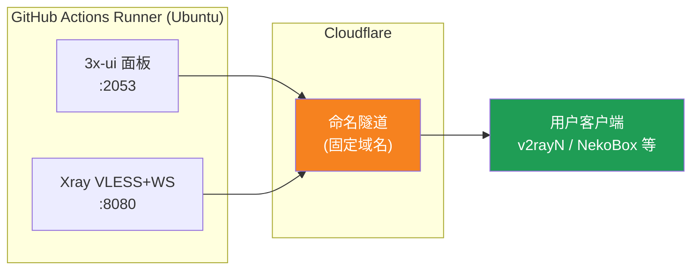
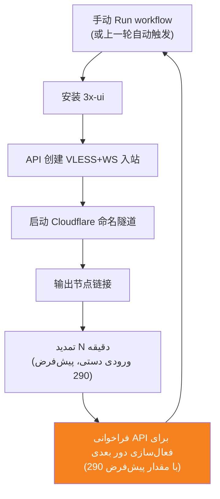
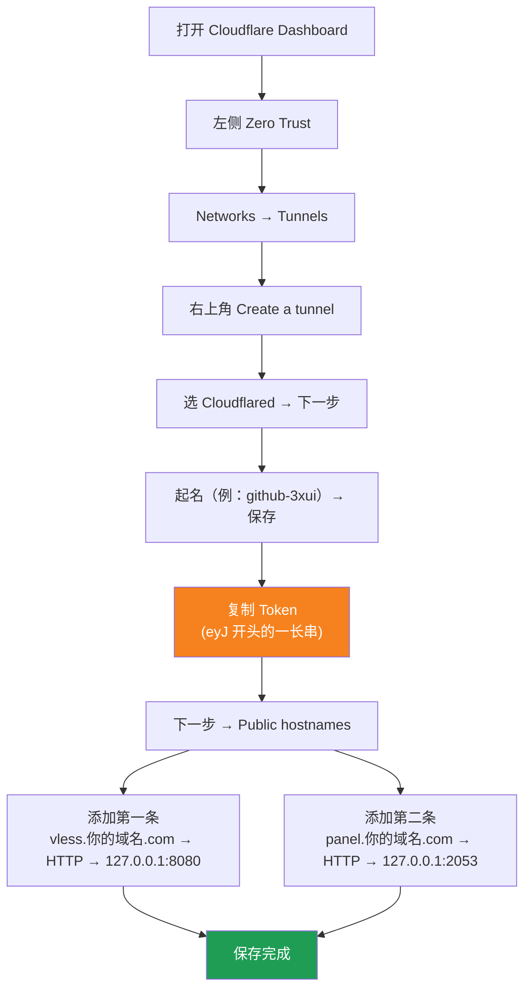

[简体中文](README.md) | [English](README.en.md) | [Русский](README.ru.md) | [日本語](README.ja.md) | [한국어](README.ko.md) | [Español](README.es.md) | [العربية](README.ar.md) | [Čeština](README.cs.md) | [Dansk](README.da.md) | [Deutsch](README.de.md) | [Esperanto](README.eo.md) | [فارسی](README.fa.md) | [Suomi](README.fi.md) | [Français](README.fr.md) | [Ελληνικά](README.gr.md) | [Magyar](README.hu.md) | [Bahasa Indonesia](README.id.md) | [Italiano](README.it.md) | [മലയാളം](README.ml.md) | [Nederlands](README.nl.md) | [Norsk](README.no.md) | [Polski](README.pl.md) | [Português](README.ptbr.md) | [Română](README.ro.md) | [Türkçe](README.tr.md) | [Українська](README.ua.md) | [Tiếng Việt](README.vn.md)

# ☁️ cloud-3xui — نود رایگان VLESS با GitHub

با سرورهای رایگان GitHub Actions به‌صورت خودکار پنل 3x-ui + نود VLESS بسازید؛ دامنهٔ ثابت، تمدید خودکار پس از قطعی.

## نمودار معماری



## روند تمدید خودکار



## تمدید خودکار

- **مدت زنده نگه داشتن را خودتان تعیین کنید**: هنگام کلیک روی Run workflow، فیلد `run_minutes` را به‌صورت دستی پر کنید؛ هر چقدر وارد کنید همان‌قدر اجرا می‌شود؛ اگر خالی بگذارید مقدار پیش‌فرض 290 استفاده می‌شود
- **فعال‌سازی خودکار از مقدار پیش‌فرض استفاده می‌کند**: در پایان هر دور، با فراخوانی API دور بعدی فعال می‌شود؛ فعال‌سازی با API پارامتر ندارد، پس هر دور تمدید خودکار 290 دقیقه است
- اگر می‌خواهید موقتاً تست کنید `5` وارد کنید؛ برای استفادهٔ روزمره خالی بگذارید تا همان 290 پیش‌فرض اعمال شود
- دامنه و UUID ثابت هستند؛ کلاینت را یک بار پیکربندی کنید و برای همیشه معتبر است
- برای توقف، به صفحهٔ Actions بروید و روی Cancel کلیک کنید؛ پس از لغو، دیگر به‌صورت خودکار راه‌اندازی نمی‌شود

## آدرس‌های ثابت

| کاربرد | آدرس |
|------|------|
| نود | `vless.my-github.ccwu.cc:443`（VLESS + WebSocket + TLS） |
| پنل | `https://panel.my-github.ccwu.cc/panel`（نام کاربری `admin`） |

> ⚠️ دامنه‌های بالا صرفاً نمونه هستند؛ آن‌ها را با دامنهٔ خودتان جایگزین کنید.

## مراحل پیکربندی تفصیلی

### دامنه رایگان (دامنه ندارید؟ از اینجا شروع کنید)

دامنه اختصاصی ندارید؟ از https://my.dnshe.com/ یک دامنه رایگان بگیرید (مثلاً `.ccwu.cc`، با اعتبار ۱۰ ساله)، سپس رکوردهای NS دامنه را به Cloudflare منتقل کنید.

### گام اول: ساخت تونل نام‌دار (Named Tunnel) در Cloudflare


وب‌سایت رسمی Cloudflare: https://www.cloudflare-cn.com (چین) / https://www.cloudflare.com (بین‌المللی)
داشبورد: https://dash.cloudflare.com



1. [داشبورد Cloudflare](https://dash.cloudflare.com) را باز کنید و از منوی سمت چپ وارد **Zero Trust** شوید.
2. از سمت چپ **Networks** → **Tunnels** را انتخاب و روی **Create a tunnel** در گوشهٔ بالا-راست کلیک کنید.
3. نوع **Cloudflared** را انتخاب و به مرحلهٔ بعد بروید.
4. یک نام برای تونل انتخاب کنید (مثلاً `github-3xui`) و ذخیره کنید.
5. صفحه یک دستور نصب نمایش می‌دهد، شبیه:
   ```
   cloudflared.exe service install eyJhIjoiYzEyNGI2...
   ```
   رشتهٔ طولانی که با `eyJ` شروع می‌شود را کپی کنید؛ این همان **Tunnel Token** است و آن را نگه دارید.
6. روی «بعدی» کلیک کنید تا وارد **Public hostnames** (مسیرهای برنامهٔ منتشرشده) شوید و روی **Add a public hostname** کلیک کنید تا دو مورد اضافه شود:

   **مورد اول (نود):**
   - Subdomain（زیردامنه）: `vless`
   - Domain（دامنه）: دامنهٔ خودتان را انتخاب کنید
   - Service Type（نوع سرویس）: `HTTP`
   - URL: `127.0.0.1:8080`

   **مورد دوم (پنل):**
   - Subdomain（زیردامنه）: `panel`
   - Domain（دامنه）: دامنهٔ خودتان را انتخاب کنید
   - Service Type（نوع سرویس）: `HTTP`
   - URL: `127.0.0.1:2053`

7. ذخیره کنید. Cloudflare به‌صورت خودکار رکوردهای DNS را می‌سازد و نیازی به افزودن دستی نیست.

### گام دوم: تولید UUID

1. https://1024tools.com/uuid/ را باز کنید.
2. UUID تولیدشده را کپی کنید (شبیه `cbfc229f-9d34-4fef-9990-8baa82a7327b`).
3. **حتماً این UUID را نگه دارید**؛ در لاگ‌های ورک‌فلو به‌صورت متن ساده نمایش داده نمی‌شود و هر بار برای ساخت لینک نود به آن نیاز دارید.

### گام سوم: افزودن Secrets در GitHub

1. وارد همین مخزن شوید و روی زبانهٔ **Settings** کلیک کنید.
2. از سمت چپ **Secrets and variables** → **Actions**.
3. روی **New repository secret** در گوشهٔ بالا-راست کلیک کنید و این سه مورد را به‌ترتیب اضافه کنید:

   | Name | Secret（مقدار） | توضیح |
   |------|-------------|------|
   | `CF_TUNNEL_TOKEN` | Tunnel Token کپی‌شده در گام اول | اعتبارنامهٔ تونل Cloudflare |
   | `PANEL_PASSWORD` | رمز عبوری که خودتان تعیین می‌کنید | رمز ورود به پنل 3x-ui |
   | `VLESS_UUID` | UUID تولیدشده در گام دوم | UUID نود، ثابت و بدون تغییر |

### گام چهارم: اجرای ورک‌فلو

1. روی زبانهٔ **Actions** در بالای مخزن کلیک کنید.
2. از سمت چپ **3x-ui VLESS Node** را انتخاب کنید.
3. روی دکمهٔ **Run workflow** در سمت راست کلیک کنید.
4. در فرم بازشده:
   - **Panel password**: خالی بگذارید (به‌صورت خودکار از secret مربوط به `PANEL_PASSWORD` استفاده می‌شود)
     رمز پنل (خالی بگذارید تا از secret مربوط به PANEL_PASSWORD استفاده شود)
   - **Run duration**: پیش‌فرض `290` (دقیقه)؛ برای تست اول می‌توانید `5` وارد کنید تا سریع بررسی شود؛ برای استفادهٔ روزمره خالی بگذارید
     مدت اجرا (دقیقه، پیش‌فرض 290، حداکثر 340)
5. روی دکمهٔ سبز **Run workflow** کلیک کنید تا اجرا شروع شود.

### گام پنجم: دریافت لینک نود

1. حدود 2 تا 3 دقیقه صبر کنید، سپس روی اجرای در حال انجام کلیک کنید تا وارد صفحهٔ جزئیات شوید.
2. مرحلهٔ **Start named Cloudflare tunnel** را باز کنید و خروجی لاگ را ببینید:
   ```
   ==================================================
     پنل Panel: https://panel.my-github.ccwu.cc/panel  (admin / رمز شما your password)

     نود VLESS node:
     vless://YOUR_UUID@vless.my-github.ccwu.cc:443?encryption=none&security=tls&sni=vless.my-github.ccwu.cc&type=ws&path=%2Fws#GitHub-3xui

     YOUR_UUID را با UUIDای که در secret مربوط به VLESS_UUID وارد کرده‌اید جایگزین کنید
     Replace YOUR_UUID with the UUID from your VLESS_UUID secret
   ==================================================
   ```
3. لینک `vless://` را کپی کنید و `YOUR_UUID` را با UUID خودتان جایگزین کنید.
4. آن را در کلاینت‌هایی مانند v2rayN / v2rayNG / Streisand / NekoBox بچسبانید تا استفاده کنید.

### گام ششم: بررسی تمدید خودکار (اختیاری)

1. در اجرای اول، مدت زمان را `5` دقیقه تنظیم کنید.
2. پس از 5 دقیقه، لاگ مرحلهٔ پایانی **Trigger next run** را بررسی کنید؛ باید این را نشان دهد:
   ```
   HTTP 204
   اجرای بعدی فعال شد Next run triggered
   ```
3. به فهرست Actions برگردید؛ باید یک اجرای جدیدِ فعال‌شدهٔ خودکار ظاهر شده باشد.
4. پس از اطمینان، دوباره اجرا کنید و مدت زمان را به `290` برگردانید تا به‌صورت عادی استفاده شود.

## توضیح مراحل ورک‌فلو

| مرحله | فارسی | English | توضیحات |
|------|------|---------|------|
| Install 3x-ui | نصب 3x-ui | Install 3x-ui | نصب غیرتعاملی پنل با اسکریپت رسمی |
| Create VLESS+WS inbound via API | ساخت اینباند VLESS+WS از طریق API | Create VLESS+WS inbound via API | ورود با API Token و ساخت خودکار اینباند |
| Start named Cloudflare tunnel | راه‌اندازی تونل نام‌دار Cloudflare | Start named Cloudflare tunnel | اتصال تونل دامنهٔ ثابت با Token |
| Keep alive | زنده نگه داشتن | Keep alive | خواب برای دقایق مشخص‌شده و پایش وضعیت سرویس‌ها |
| Trigger next run | فعال‌سازی اجرای بعدی | Trigger next run | فراخوانی API برای راه‌اندازی خودکار دور بعدی |

## پرسش‌های متداول

**س: UUID در لینک نود داخل لاگ به‌صورت `***` نمایش داده می‌شود؟**
ج: این مکانیزم محافظت از secret در GitHub است. `YOUR_UUID` را با UUIDای که خودتان در secret مربوط به `VLESS_UUID` وارد کرده‌اید جایگزین کنید.

**س: تست کلاینت ناموفق است (-1)؟**
ج: سه مورد را بررسی کنید: ① آیا UUID درست جایگزین شده است؛ ② آیا نسخهٔ کلاینت جدید است (v2rayN نسخهٔ 7.x به بالا)؛ ③ آیا تونل Cloudflare به‌درستی متصل است (لاگ را ببینید).

**س: راه‌اندازی مجدد خودکار فعال نشد؟**
ج: لاگ مرحلهٔ **Trigger next run** را بررسی کنید. اگر کد وضعیت HTTP غیر از 204 نمایش داده شد، تنظیمات دسترسی Actions مخزن را بررسی کنید.

**س: آیا قطعی چنددقیقه‌ای هر 5 ساعت طبیعی است؟**
ج: بله، طبیعی است. از پایان دور قبلی تا اتصال تونل در دور بعدی حدود 3 تا 5 دقیقه طول می‌کشد و کلاینت به‌صورت خودکار دوباره متصل می‌شود.

**س: چطور تمدید خودکار را متوقف کنم؟**
ج: به صفحهٔ Actions بروید و اجرای جاری را Cancel کنید؛ دیگر به‌صورت خودکار فعال نمی‌شود.

## نکات

- **سرعت**: ترافیک از Cloudflare ← دیتاسنترهای GitHub (آمریکا/اروپا) عبور می‌کند؛ فقط برای استفادهٔ موقت/سبک مناسب است
- **قطعی کوتاه**: در هر راه‌اندازی مجدد خودکار هنگام تحویل، حدود 3 تا 5 دقیقه قطع می‌شود (بالا آمدن ماشین جدید، نصب 3x-ui، اتصال مجدد تونل)؛ کلاینت به‌صورت خودکار دوباره متصل می‌شود
- **مقررات**: اجرای پروکسی در GitHub Actions ممکن است خلاف ToS باشد و خطر مسدود شدن حساب را دارد؛ خودتان ارزیابی کنید
- **امنیت**: `CF_TUNNEL_TOKEN` / `PANEL_PASSWORD` / `VLESS_UUID` را در جاهای عمومی منتشر نکنید
