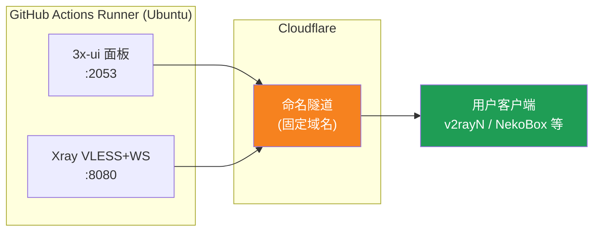
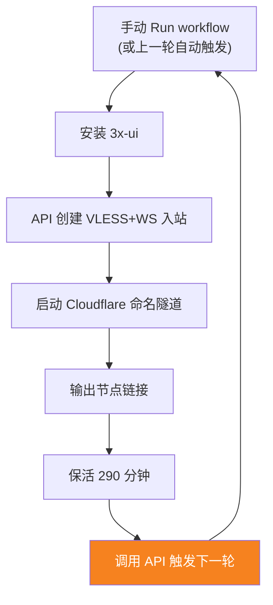

[简体中文](README.md) | [English](README.en.md) | [Русский](README.ru.md) | [日本語](README.ja.md) | [한국어](README.ko.md) | [Español](README.es.md) | [العربية](README.ar.md) | [Čeština](README.cs.md) | [Dansk](README.da.md) | [Deutsch](README.de.md) | [Esperanto](README.eo.md) | [فارسی](README.fa.md) | [Suomi](README.fi.md) | [Français](README.fr.md) | [Ελληνικά](README.gr.md) | [Magyar](README.hu.md) | [Bahasa Indonesia](README.id.md) | [Italiano](README.it.md) | [മലയാളം](README.ml.md) | [Nederlands](README.nl.md) | [Norsk](README.no.md) | [Polski](README.pl.md) | [Português](README.ptbr.md) | [Română](README.ro.md) | [Türkçe](README.tr.md) | [Українська](README.ua.md) | [Tiếng Việt](README.vn.md)

# ☁️ cloud-3xui — Ilmainen VLESS-solmu GitHubissa

Rakenna automaattisesti 3x-ui-paneeli + VLESS-solmu GitHub Actionsin ilmaisilla palvelimilla, kiinteällä verkkotunnuksella ja automaattisella elvytyksellä katkoksen jälkeen.

## Arkkitehtuurikaavio



## Automaattisen elvytyksen prosessi



## Kiinteät osoitteet

| Käyttötarkoitus | Osoite |
|------|------|
| Solmu | `vless.my-github.ccwu.cc:443`（VLESS + WebSocket + TLS） |
| Paneeli | `https://panel.my-github.ccwu.cc/panel`（käyttäjänimi `admin`） |

> ⚠️ Yllä olevat verkkotunnukset ovat esimerkkejä; korvaa ne omalla verkkotunnuksellasi.

## Yksityiskohtaiset määritysvaiheet

### Vaihe 1: Luo nimetty tunneli Cloudflaressa

1. Avaa [Cloudflare Dashboard](https://dash.cloudflare.com) ja siirry vasemman valikon **Zero Trust**-osioon.
2. Valitse vasemmalta **Networks** → **Tunnels** ja napsauta oikeassa yläkulmassa **Create a tunnel**.
3. Valitse tyyppi **Cloudflared** ja jatka eteenpäin.
4. Anna tunnelille nimi (esim. `github-3xui`) ja tallenna.
5. Sivu näyttää asennuskomennon, esimerkiksi:
   ```
   cloudflared.exe service install eyJhIjoiYzEyNGI2...
   ```
   Kopioi `eyJ`-alkuinen pitkä merkkijono – se on **Tunnel Token** – ja tallenna se.
6. Napsauta Seuraava siirtyäksesi **Public hostnames** (julkaistut sovellusreitit) -osioon ja lisää kaksi kohtaa napsauttamalla **Add a public hostname**:

   **Ensimmäinen (solmu):**
   - Subdomain (aliverkkotunnus): `vless`
   - Domain (verkkotunnus): valitse oma verkkotunnuksesi
   - Service Type (palvelutyyppi): `HTTP`
   - URL: `127.0.0.1:8080`

   **Toinen (paneeli):**
   - Subdomain (aliverkkotunnus): `panel`
   - Domain (verkkotunnus): valitse oma verkkotunnuksesi
   - Service Type (palvelutyyppi): `HTTP`
   - URL: `127.0.0.1:2053`

7. Tallenna. Cloudflare luo DNS-tietueet automaattisesti, eikä niitä tarvitse lisätä käsin.

### Vaihe 2: Luo UUID

1. Avaa https://1024tools.com/uuid/
2. Kopioi luotu UUID (esim. `cbfc229f-9d34-4fef-9990-8baa82a7327b`)
3. **Pidä tämä UUID ehdottomasti tallessa** – se ei näy selväkielisenä työnkulun lokeissa, ja tarvitset sitä joka kerta kootessasi solmulinkkiä

### Vaihe 3: Lisää GitHub-secretsit

1. Siirry tähän repositorioon ja napsauta **Settings**-välilehteä.
2. Valitse vasemmalta **Secrets and variables** → **Actions**.
3. Napsauta oikeassa yläkulmassa **New repository secret** ja lisää nämä kolme järjestyksessä:

   | Name | Secret (arvo) | Selitys |
   |------|-------------|------|
   | `CF_TUNNEL_TOKEN` | Vaiheessa 1 kopioitu Tunnel Token | Cloudflare-tunnelin tunnistetieto |
   | `PANEL_PASSWORD` | Itse asettamasi paneelin salasana | 3x-ui-paneelin kirjautumissalasana |
   | `VLESS_UUID` | Vaiheessa 2 luotu UUID | Solmun UUID, pysyvästi muuttumaton |

### Vaihe 4: Aja työnkulku

1. Napsauta repositorion yläosassa olevaa **Actions**-välilehteä.
2. Valitse vasemmalta **3x-ui VLESS Node**.
3. Napsauta oikealla olevaa **Run workflow**-painiketta.
4. Avautuvassa lomakkeessa:
   - **Panel password**: jätä tyhjäksi (käyttää automaattisesti `PANEL_PASSWORD`-secretiä)
     Paneelin salasana (tyhjä = käytetään PANEL_PASSWORD-secretiä)
   - **Run duration**: oletus `290` (minuuttia); ensimmäisessä testissä voit syöttää `5` nopeaa varmennusta varten
     Ajoaika (minuuttia, oletus 290, enintään 340)
5. Napsauta vihreää **Run workflow**-painiketta aloittaaksesi ajon.

### Vaihe 5: Hae solmulinkki

1. Odota noin 2–3 minuuttia ja napsauta käynnissä olevaa ajoa siirtyäksesi sen tietosivulle.
2. Laajenna vaihe **Start named Cloudflare tunnel** ja tarkista lokituloste:
   ```
   ==================================================
     Paneeli Panel: https://panel.my-github.ccwu.cc/panel  (admin / salasanasi your password)

     VLESS-solmu node:
     vless://YOUR_UUID@vless.my-github.ccwu.cc:443?encryption=none&security=tls&sni=vless.my-github.ccwu.cc&type=ws&path=%2Fws#GitHub-3xui

     Korvaa YOUR_UUID sillä UUID:llä, jonka syötit VLESS_UUID-secretiin
     Replace YOUR_UUID with the UUID from your VLESS_UUID secret
   ==================================================
   ```
3. Kopioi `vless://`-linkki ja korvaa `YOUR_UUID` omalla UUID:lläsi.
4. Liitä se v2rayN / v2rayNG / Streisand / NekoBox -asiakasohjelmaan, niin voit käyttää sitä.

### Vaihe 6: Varmista automaattinen elvytys (valinnainen)

1. Aseta ensimmäisessä ajossa kesto `5` minuutiksi.
2. Tarkista 5 minuutin kuluttua viimeisen vaiheen **Trigger next run** loki; sen pitäisi näyttää:
   ```
   HTTP 204
   Seuraava ajo käynnistetty Next run triggered
   ```
3. Palaa Actions-listaan – siinä pitäisi näkyä uusi automaattisesti käynnistetty ajo.
4. Kun olet varmistunut, aja uudelleen ja palauta kesto arvoon `290` normaalia käyttöä varten.

## Työnkulun vaiheiden selitykset

| Vaihe | Suomeksi | English | Selitys |
|------|------|---------|------|
| Install 3x-ui | Asenna 3x-ui | Install 3x-ui | Asenna paneeli virallisella komentosarjalla ilman vuorovaikutusta |
| Create VLESS+WS inbound via API | Luo VLESS+WS-saapuva API:n kautta | Create VLESS+WS inbound via API | Kirjaudu API-tokenilla, luo saapuva automaattisesti |
| Start named Cloudflare tunnel | Käynnistä Cloudflaren nimetty tunneli | Start named Cloudflare tunnel | Yhdistä kiinteän verkkotunnuksen tunneli tokenilla |
| Keep alive | Pidä elossa | Keep alive | Lepää määritetyt minuutit, valvo palveluiden tilaa |
| Trigger next run | Käynnistä seuraava ajo | Trigger next run | Kutsu API:ia käynnistääksesi seuraavan kierroksen automaattisesti |

## Usein kysytyt kysymykset

**K: Solmulinkin UUID näkyy lokeissa muodossa `***`?**
V: Tämä on GitHubin secret-suojausmekanismi. Korvaa `YOUR_UUID` sillä UUID:llä, jonka syötit `VLESS_UUID`-secretiin.

**K: Asiakasohjelman testi ei mene läpi (-1)?**
V: Tarkista kolme asiaa: ① onko UUID korvattu oikein; ② onko asiakasohjelman versio tarpeeksi uusi (v2rayN 7.x+); ③ onko Cloudflare-tunneli yhdistetty normaalisti (katso lokia).

**K: Automaattinen uudelleenkäynnistys ei käynnistynyt?**
V: Tarkista vaiheen **Trigger next run** loki. Jos näet muun kuin 204:n HTTP-tilakoodin, tarkista repositorion Actions-käyttöoikeusasetukset.

**K: Onko muutaman minuutin katkos 5 tunnin välein normaalia?**
V: On. Edellisen kierroksen päättymisestä seuraavan kierroksen tunnelin yhdistymiseen kuluu noin 3–5 minuuttia, ja asiakasohjelma yhdistää automaattisesti uudelleen.

**K: Haluatko pysäyttää automaattisen elvytyksen?**
V: Siirry Actions-sivulle ja peruuta (Cancel) nykyinen ajo – se ei enää käynnisty automaattisesti.

## Huomioitavaa

- **Nopeus**: liikenne kulkee Cloudflare → GitHubin palvelinkeskukset (Yhdysvallat/Eurooppa) -reitin kautta, sopii vain tilapäiseen/kevyeen käyttöön
- **Lyhyt katkos**: jokaisen automaattisen uudelleenkäynnistyksen vaihdon yhteydessä on noin 3–5 minuutin katkos (uuden koneen käynnistys, 3x-ui:n asennus, tunnelin uudelleenyhdistys), asiakasohjelma yhdistää automaattisesti uudelleen
- **Sääntöjenmukaisuus**: välityspalvelimen ajaminen GitHub Actionsissa saattaa rikkoa käyttöehtoja ja aiheuttaa tilin jäädytyksen riskin; arvioi itse
- **Turvallisuus**: älä julkaise `CF_TUNNEL_TOKEN` / `PANEL_PASSWORD` / `VLESS_UUID` julkisesti
