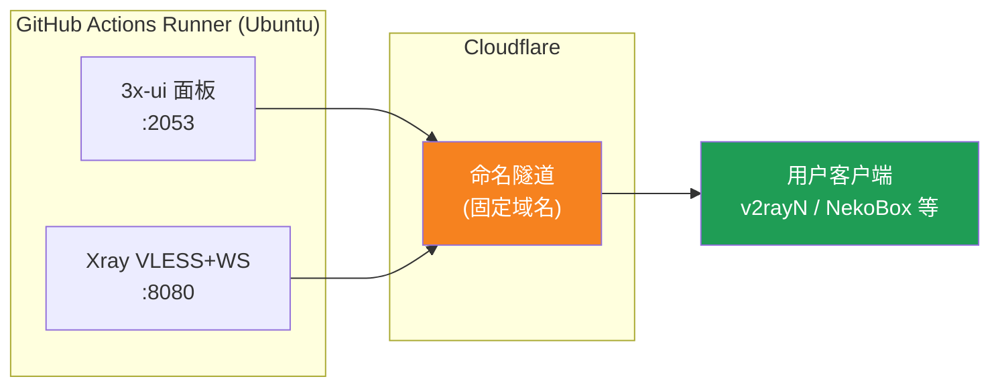
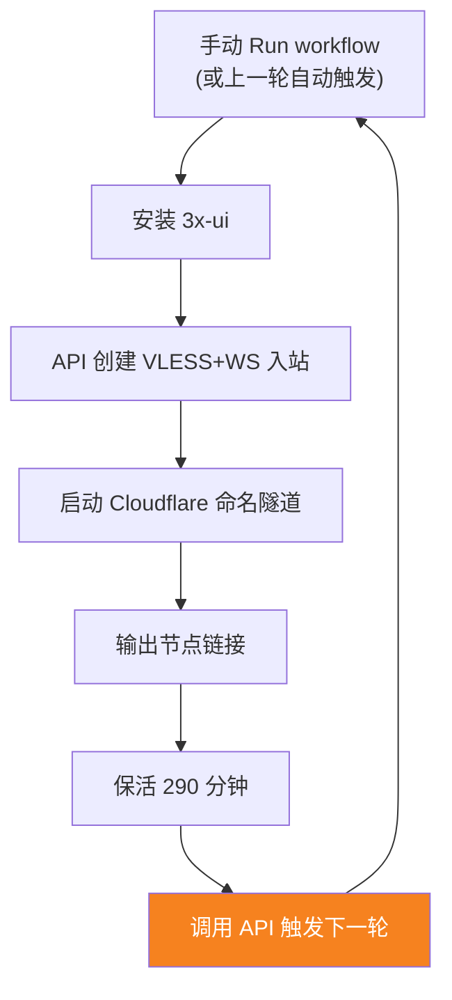

[简体中文](README.md) | [English](README.en.md) | [Русский](README.ru.md) | [日本語](README.ja.md) | [한국어](README.ko.md) | [Español](README.es.md) | [العربية](README.ar.md) | [Čeština](README.cs.md) | [Dansk](README.da.md) | [Deutsch](README.de.md) | [Esperanto](README.eo.md) | [فارسی](README.fa.md) | [Suomi](README.fi.md) | [Français](README.fr.md) | [Ελληνικά](README.gr.md) | [Magyar](README.hu.md) | [Bahasa Indonesia](README.id.md) | [Italiano](README.it.md) | [മലയാളം](README.ml.md) | [Nederlands](README.nl.md) | [Norsk](README.no.md) | [Polski](README.pl.md) | [Português](README.ptbr.md) | [Română](README.ro.md) | [Türkçe](README.tr.md) | [Українська](README.ua.md) | [Tiếng Việt](README.vn.md)

# ☁️ cloud-3xui — Δωρεάν κόμβος VLESS στο GitHub

Αυτόματη εγκατάσταση του πάνελ 3x-ui + κόμβου VLESS στους δωρεάν διακομιστές του GitHub Actions, με σταθερό domain και αυτόματη ανανέωση σε περίπτωση αποσύνδεσης.

## Διάγραμμα αρχιτεκτονικής



## Διαδικασία αυτόματης ανανέωσης



## Σταθερές διευθύνσεις

| Χρήση | Διεύθυνση |
|------|------|
| Κόμβος | `vless.my-github.ccwu.cc:443` (VLESS + WebSocket + TLS) |
| Πάνελ | `https://panel.my-github.ccwu.cc/panel` (όνομα χρήστη `admin`) |

> ⚠️ Τα παραπάνω domain είναι παραδείγματα, αντικαταστήστε τα με τα δικά σας.

## Αναλυτικά βήματα ρύθμισης

### Βήμα 1: Δημιουργία ονοματισμένης σήραγγας (named tunnel) στο Cloudflare

1. Ανοίξτε το [Cloudflare Dashboard](https://dash.cloudflare.com) και μεταβείτε στο **Zero Trust** από το αριστερό μενού
2. Στα αριστερά, **Networks** → **Tunnels**, κάντε κλικ στο **Create a tunnel** πάνω δεξιά
3. Επιλέξτε τον τύπο **Cloudflared** και κάντε κλικ στο επόμενο
4. Δώστε ένα όνομα στη σήραγγα (π.χ. `github-3xui`) και αποθηκεύστε
5. Η σελίδα θα εμφανίσει μια εντολή εγκατάστασης, όπως:
   ```
   cloudflared.exe service install eyJhIjoiYzEyNGI2...
   ```
   Αντιγράψτε τη μεγάλη σειρά χαρακτήρων που ξεκινά με `eyJ` — αυτό είναι το **Tunnel Token**, κρατήστε το καλά
6. Κάντε κλικ στο επόμενο για να μπείτε στα **Public hostnames** (δημοσιευμένες διαδρομές εφαρμογών) και κάντε κλικ στο **Add a public hostname** για να προσθέσετε δύο εγγραφές:

   **Πρώτη εγγραφή (κόμβος):**
   - Subdomain (υποτομέας): `vless`
   - Domain (domain): επιλέξτε το δικό σας domain
   - Service Type (τύπος υπηρεσίας): `HTTP`
   - URL: `127.0.0.1:8080`

   **Δεύτερη εγγραφή (πάνελ):**
   - Subdomain (υποτομέας): `panel`
   - Domain (domain): επιλέξτε το δικό σας domain
   - Service Type (τύπος υπηρεσίας): `HTTP`
   - URL: `127.0.0.1:2053`

7. Αποθηκεύστε. Το Cloudflare θα δημιουργήσει αυτόματα την ανάλυση DNS, δεν χρειάζεται χειροκίνητη προσθήκη.

### Βήμα 2: Δημιουργία UUID

1. Ανοίξτε το https://1024tools.com/uuid/
2. Αντιγράψτε το παραγόμενο UUID (όπως `cbfc229f-9d34-4fef-9990-8baa82a7327b`)
3. **Κρατήστε οπωσδήποτε σημειωμένο αυτό το UUID** — δεν εμφανίζεται σε καθαρό κείμενο στα logs του workflow και το χρειάζεστε κάθε φορά που συνθέτετε τον σύνδεσμο του κόμβου

### Βήμα 3: Προσθήκη Secrets στο GitHub

1. Μεταβείτε σε αυτό το αποθετήριο και κάντε κλικ στην καρτέλα **Settings**
2. Στα αριστερά, **Secrets and variables** → **Actions**
3. Κάντε κλικ στο **New repository secret** πάνω δεξιά και προσθέστε τα τρία διαδοχικά:

   | Name | Secret (τιμή) | Περιγραφή |
   |------|-------------|------|
   | `CF_TUNNEL_TOKEN` | Το Tunnel Token που αντιγράψατε στο βήμα 1 | Διαπιστευτήρια σήραγγας Cloudflare |
   | `PANEL_PASSWORD` | Ο κωδικός πάνελ που ορίσατε | Κωδικός σύνδεσης στο πάνελ 3x-ui |
   | `VLESS_UUID` | Το UUID που δημιουργήσατε στο βήμα 2 | UUID κόμβου, σταθερό |

### Βήμα 4: Εκτέλεση του workflow

1. Κάντε κλικ στην καρτέλα **Actions** στο πάνω μέρος του αποθετηρίου
2. Στα αριστερά επιλέξτε **3x-ui VLESS Node**
3. Κάντε κλικ στο κουμπί **Run workflow** στα δεξιά
4. Στη φόρμα που εμφανίζεται:
   - **Panel password**: αφήστε κενό (χρησιμοποιείται αυτόματα το secret `PANEL_PASSWORD`)
     Κωδικός πάνελ (αν μείνει κενό, χρησιμοποιείται το secret PANEL_PASSWORD)
   - **Run duration**: προεπιλογή `290` (λεπτά), για την πρώτη δοκιμή μπορείτε να βάλετε `5` για γρήγορη επαλήθευση
     Διάρκεια εκτέλεσης (σε λεπτά, προεπιλογή 290, μέγιστο 340)
5. Κάντε κλικ στο πράσινο κουμπί **Run workflow** για να ξεκινήσει

### Βήμα 5: Λήψη του συνδέσμου του κόμβου

1. Περιμένετε περίπου 2-3 λεπτά και κάντε κλικ στην εκτελούμενη εργασία για να μπείτε στη σελίδα λεπτομερειών
2. Αναπτύξτε το βήμα **Start named Cloudflare tunnel** και δείτε την έξοδο του log:
   ```
   ==================================================
     面板 Panel: https://panel.my-github.ccwu.cc/panel  (admin / 你的密码 your password)

     VLESS 节点 node:
     vless://YOUR_UUID@vless.my-github.ccwu.cc:443?encryption=none&security=tls&sni=vless.my-github.ccwu.cc&type=ws&path=%2Fws#GitHub-3xui

     把 YOUR_UUID 换成你在 VLESS_UUID secret 里填的 UUID
     Replace YOUR_UUID with the UUID from your VLESS_UUID secret
   ==================================================
   ```
3. Αντιγράψτε τον σύνδεσμο `vless://` και αντικαταστήστε το `YOUR_UUID` με το δικό σας UUID
4. Επικολλήστε τον σε έναν client όπως v2rayN / v2rayNG / Streisand / NekoBox και είστε έτοιμοι

### Βήμα 6: Επαλήθευση της αυτόματης ανανέωσης (προαιρετικό)

1. Για την πρώτη εκτέλεση, ορίστε τη διάρκεια στα `5` λεπτά
2. Μετά από 5 λεπτά, δείτε το log του τελευταίου βήματος **Trigger next run**, θα πρέπει να εμφανίζει:
   ```
   HTTP 204
   已触发下一次运行 Next run triggered
   ```
3. Επιστρέψτε στη λίστα Actions, θα πρέπει να εμφανιστεί μια νέα αυτόματα ενεργοποιημένη εκτέλεση
4. Αφού το επιβεβαιώσετε, εκτελέστε ξανά με τη διάρκεια πίσω στα `290` για κανονική χρήση

## Περιγραφή των βημάτων του workflow

| Βήμα | Ελληνικά | English | Περιγραφή |
|------|------|---------|------|
| Install 3x-ui | Εγκατάσταση 3x-ui | Install 3x-ui | Μη διαδραστική εγκατάσταση του πάνελ με το επίσημο script |
| Create VLESS+WS inbound via API | Δημιουργία VLESS+WS inbound μέσω API | Create VLESS+WS inbound via API | Σύνδεση με API Token, αυτόματη δημιουργία inbound |
| Start named Cloudflare tunnel | Εκκίνηση ονοματισμένης σήραγγας Cloudflare | Start named Cloudflare tunnel | Σύνδεση στη σήραγγα σταθερού domain με Token |
| Keep alive | Διατήρηση ενεργού (keep alive) | Keep alive | Αναστολή για τα καθορισμένα λεπτά, παρακολούθηση κατάστασης υπηρεσιών |
| Trigger next run | Ενεργοποίηση επόμενης εκτέλεσης | Trigger next run | Κλήση API για αυτόματη εκκίνηση του επόμενου γύρου |

## Συχνές ερωτήσεις

**Q: Το UUID στον σύνδεσμο του κόμβου εμφανίζεται ως `***` στο log;**
A: Αυτό είναι ο μηχανισμός προστασίας secrets του GitHub. Αντικαταστήστε απλώς το `YOUR_UUID` με το UUID που βάλατε στο secret `VLESS_UUID`.

**Q: Ο client αποτυγχάνει στη δοκιμή (-1);**
A: Ελέγξτε τρία σημεία: ① αν το UUID αντικαταστάθηκε σωστά· ② αν η έκδοση του client είναι αρκετά νέα (v2rayN 7.x+)· ③ αν η σήραγγα Cloudflare συνδέθηκε κανονικά (δείτε το log).

**Q: Η αυτόματη επανεκκίνηση δεν ενεργοποιήθηκε;**
A: Δείτε το log του βήματος **Trigger next run**. Αν εμφανίζεται HTTP κωδικός διαφορετικός από 204, ελέγξτε τις ρυθμίσεις δικαιωμάτων Actions του αποθετηρίου.

**Q: Είναι φυσιολογικό να διακόπτεται για λίγα λεπτά κάθε 5 ώρες;**
A: Φυσιολογικό. Από το τέλος του προηγούμενου γύρου μέχρι τη σύνδεση της σήραγγας του επόμενου χρειάζονται περίπου 3-5 λεπτά, ο client θα επανασυνδεθεί αυτόματα.

**Q: Θέλετε να σταματήσετε την αυτόματη ανανέωση;**
A: Μεταβείτε στη σελίδα Actions και κάντε Cancel την τρέχουσα εκτέλεση, δεν θα ενεργοποιηθεί ξανά αυτόματα.

## Σημειώσεις

- **Ταχύτητα**: η κίνηση περνά μέσω Cloudflare → κέντρων δεδομένων GitHub (ΗΠΑ/ΕΕ), κατάλληλο μόνο για προσωρινή/ελαφριά χρήση
- **Σύντομη διακοπή**: σε κάθε αυτόματη επανεκκίνηση ανά 5 ώρες υπάρχει διακοπή περίπου 3-5 λεπτών (εκκίνηση νέου μηχανήματος, εγκατάσταση 3x-ui, επανασύνδεση σήραγγας), ο client θα επανασυνδεθεί αυτόματα
- **Συμμόρφωση**: η εκτέλεση proxy στο GitHub Actions μπορεί να παραβιάζει τους Όρους Χρήσης (ToS) με κίνδυνο αποκλεισμού του λογαριασμού, αξιολογήστε το μόνοι σας
- **Ασφάλεια**: μην δημοσιεύετε τα `CF_TUNNEL_TOKEN` / `PANEL_PASSWORD` / `VLESS_UUID` σε δημόσιους χώρους
