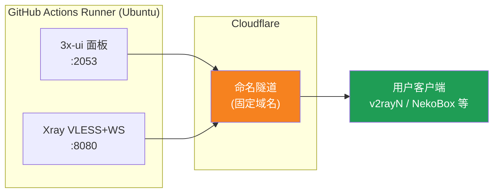
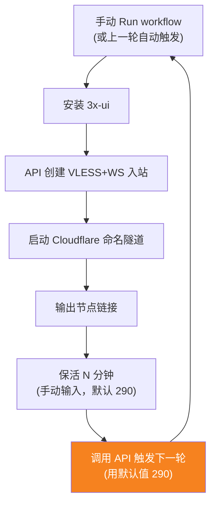

[简体中文](README.md) | [English](README.en.md) | [Русский](README.ru.md) | [日本語](README.ja.md) | [한국어](README.ko.md) | [Español](README.es.md) | [العربية](README.ar.md) | [Čeština](README.cs.md) | [Dansk](README.da.md) | [Deutsch](README.de.md) | [Esperanto](README.eo.md) | [فارسی](README.fa.md) | [Suomi](README.fi.md) | [Français](README.fr.md) | [Ελληνικά](README.gr.md) | [Magyar](README.hu.md) | [Bahasa Indonesia](README.id.md) | [Italiano](README.it.md) | [മലയാളം](README.ml.md) | [Nederlands](README.nl.md) | [Norsk](README.no.md) | [Polski](README.pl.md) | [Português](README.ptbr.md) | [Română](README.ro.md) | [Türkçe](README.tr.md) | [Українська](README.ua.md) | [Tiếng Việt](README.vn.md)

# ☁️ cloud-3xui — Ingyenes GitHub VLESS csomópont

A 3x-ui panel + VLESS csomópont automatikus felépítése a GitHub Actions ingyenes szerverein, fix domainnel, automatikus megújítással kapcsolatvesztés esetén.

## Architektúra-diagram



## Automatikus megújítási folyamat



## Automatikus megújítás

- **Az időtartamot te szabod meg**: Run workflow indításakor töltsd ki kézzel a `run_minutes` mezőt, annyi percig fut, amennyit beírsz; üresen hagyva az alapértelmezett 290 érvényes
- **Az automatikus indítás az alapértelmezettet használja**: minden kör végén az API paraméterek nélkül indítja a következőt, így az automatikus körök mindig 290 percesek
- Gyors teszthez írj `5`-öt, napi használatra hagyd üresen (290)
- A domain és az UUID fix, a klienst egyszer kell beállítani
- Leállításhoz nyomj Cancel-t az Actions oldalon, nem indul újra automatikusan

## Rögzített címek

| Használat | Cím |
|------|------|
| Csomópont | `vless.my-github.ccwu.cc:443` (VLESS + WebSocket + TLS) |
| Panel | `https://panel.my-github.ccwu.cc/panel` (felhasználónév: `admin`) |

> ⚠️ A fenti domainek csak példák, cseréld le a sajátjaidra.

## Részletes konfigurációs lépések

### 1. lépés: Elnevezett Cloudflare tunnel létrehozása

1. Nyisd meg a [Cloudflare Dashboardot](https://dash.cloudflare.com), a bal oldali menüben lépj a **Zero Trust** menüpontra
2. Bal oldalt **Networks** → **Tunnels**, kattints jobb felül a **Create a tunnel** gombra
3. Válaszd a **Cloudflared** típust, majd kattints a Tovább gombra
4. Adj nevet a tunnelnek (pl. `github-3xui`), és mentsd el
5. Az oldal egy telepítési parancsot mutat, kb. így:
   ```
   cloudflared.exe service install eyJhIjoiYzEyNGI2...
   ```
   Másold ki a hosszú, `eyJ`-val kezdődő karaktersort — ez a **Tunnel Token**, jól őrizd meg
6. Kattints a Tovább gombra a **Public hostnames** (közzétett alkalmazás-útvonalak) részhez, majd kattints az **Add a public hostname** gombra, és add hozzá a két bejegyzést:

   **Első bejegyzés (csomópont):**
   - Subdomain (aldomain): `vless`
   - Domain (domain): válaszd ki a saját domained
   - Service Type (szolgáltatástípus): `HTTP`
   - URL: `127.0.0.1:8080`

   **Második bejegyzés (panel):**
   - Subdomain (aldomain): `panel`
   - Domain (domain): válaszd ki a saját domained
   - Service Type (szolgáltatástípus): `HTTP`
   - URL: `127.0.0.1:2053`

7. Mentsd el. A Cloudflare automatikusan létrehozza a DNS-feloldást, kézzel nem kell hozzáadnod.

### 2. lépés: UUID generálása

1. Nyisd meg: https://1024tools.com/uuid/
2. Másold ki a generált UUID-t (pl. `cbfc229f-9d34-4fef-9990-8baa82a7327b`)
3. **Mindenképp jegyezd fel ezt az UUID-t**, a workflow naplóiban nem jelenik meg nyílt szövegként, és minden egyes csomópont-link összeállításához szükséged lesz rá

### 3. lépés: GitHub Secrets hozzáadása

1. Lépj be ebbe a repóba, és kattints a **Settings** fülre
2. Bal oldalt **Secrets and variables** → **Actions**
3. Kattints jobb felül a **New repository secret** gombra, és add hozzá sorban a hármat:

   | Name | Secret (érték) | Leírás |
   |------|-------------|------|
   | `CF_TUNNEL_TOKEN` | Az 1. lépésben másolt Tunnel Token | Cloudflare tunnel hitelesítő adat |
   | `PANEL_PASSWORD` | Az általad beállított panel-jelszó | 3x-ui panel bejelentkezési jelszó |
   | `VLESS_UUID` | A 2. lépésben generált UUID | Csomópont UUID, fix, nem változik |

### 4. lépés: A workflow futtatása

1. Kattints a repó tetején az **Actions** fülre
2. Bal oldalt válaszd a **3x-ui VLESS Node** elemet
3. Kattints jobb oldalt a **Run workflow** gombra
4. A felugró űrlapon:
   - **Panel password**: hagyd üresen (automatikusan a `PANEL_PASSWORD` secretet használja)
     Panel-jelszó (üresen hagyva a PANEL_PASSWORD secretet használja)
   - **Run duration**: alapértelmezett `290` (perc), az első teszthez megadhatsz `5`-öt a gyors ellenőrzéshez
     Futási idő (perc, alapértelmezett 290, maximum 340)
5. Kattints a zöld **Run workflow** gombra a futtatás indításához

### 5. lépés: A csomópont-link lekérése

1. Várj kb. 2-3 percet, majd kattints a futó feladatra a részletek oldal megnyitásához
2. Bontsd ki a **Start named Cloudflare tunnel** lépést, és nézd meg a naplókimenetet:
   ```
   ==================================================
     面板 Panel: https://panel.my-github.ccwu.cc/panel  (admin / 你的密码 your password)

     VLESS 节点 node:
     vless://YOUR_UUID@vless.my-github.ccwu.cc:443?encryption=none&security=tls&sni=vless.my-github.ccwu.cc&type=ws&path=%2Fws#GitHub-3xui

     把 YOUR_UUID 换成你在 VLESS_UUID secret 里填的 UUID
     Replace YOUR_UUID with the UUID from your VLESS_UUID secret
   ==================================================
   ```
3. Másold ki a `vless://` linket, és cseréld le a `YOUR_UUID` részt a saját UUID-dre
4. Illeszd be v2rayN / v2rayNG / Streisand / NekoBox vagy más kliensbe, és már használhatod is

### 6. lépés: Az automatikus megújítás ellenőrzése (opcionális)

1. Az első futtatáskor állítsd az időtartamot `5` percre
2. 5 perc múlva nézd meg az utolsó lépés, a **Trigger next run** naplóját, ennek kell megjelennie:
   ```
   HTTP 204
   已触发下一次运行 Next run triggered
   ```
3. Térj vissza az Actions listára, meg kell jelennie egy új, automatikusan indított futtatásnak
4. Ha minden rendben, futtasd újra, és állítsd vissza az időtartamot `290`-re a normál használathoz

## A workflow lépéseinek leírása

| Lépés | Magyar | English | Leírás |
|------|------|---------|------|
| Install 3x-ui | 3x-ui telepítése | Install 3x-ui | A panel nem interaktív telepítése a hivatalos szkripttel |
| Create VLESS+WS inbound via API | VLESS+WS inbound létrehozása API-n keresztül | Create VLESS+WS inbound via API | Bejelentkezés API Tokennel, az inbound automatikus létrehozása |
| Start named Cloudflare tunnel | Elnevezett Cloudflare tunnel indítása | Start named Cloudflare tunnel | Csatlakozás a fix domainű tunnelhez Tokennel |
| Keep alive | Életben tartás | Keep alive | Alvás a megadott percszámig, a szolgáltatások állapotának figyelése |
| Trigger next run | A következő futtatás indítása | Trigger next run | API-hívás a következő kör automatikus elindításához |

## Gyakori kérdések

**K: A naplóban a csomópont-link UUID-je `***`-ként jelenik meg?**
V: Ez a GitHub secret-védelmi mechanizmusa. Egyszerűen cseréld le a `YOUR_UUID` részt arra az UUID-re, amit a `VLESS_UUID` secretbe írtál.

**K: A kliens tesztje nem megy át (-1)?**
V: Ellenőrizd három dolgot: ① az UUID-t helyesen cserélted-e le; ② elég új-e a kliens verziója (v2rayN 7.x+); ③ a Cloudflare tunnel rendesen csatlakozik-e (nézd a naplót).

**K: Az automatikus újraindítás nem indult el?**
V: Nézd meg a **Trigger next run** lépés naplóját. Ha nem 204-es HTTP státuszkódot mutat, ellenőrizd a repó Actions jogosultsági beállításait.

**K: Normális, ha 5 óránként pár percre megszakad?**
V: Normális. Az előző kör végétől a következő kör tunneljének csatlakozásáig kb. 3-5 perc telik el, a kliens automatikusan újracsatlakozik.

**K: Le akarom állítani az automatikus megújítást?**
V: Menj az Actions oldalra, és állítsd le (Cancel) az aktuális futtatást, többé nem indul el automatikusan.

## Megjegyzések

- **Sebesség**: a forgalom a Cloudflare → GitHub adatközpontokon (USA/EU) keresztül megy, csak ideiglenes/enyhe használatra alkalmas
- **Rövid kimaradás**: minden 5 órás automatikus újraindítás átállásakor kb. 3-5 perc kimaradás (új gép indul, 3x-ui telepítés, tunnel újracsatlakozás), a kliens automatikusan újracsatlakozik
- **Szabályosság**: GitHub Actionsön proxyt futtatni sértheti a ToS-t, fióktiltás kockázatával — mérlegeld magad
- **Biztonság**: ne tedd közzé nyilvánosan a `CF_TUNNEL_TOKEN` / `PANEL_PASSWORD` / `VLESS_UUID` értékeket
