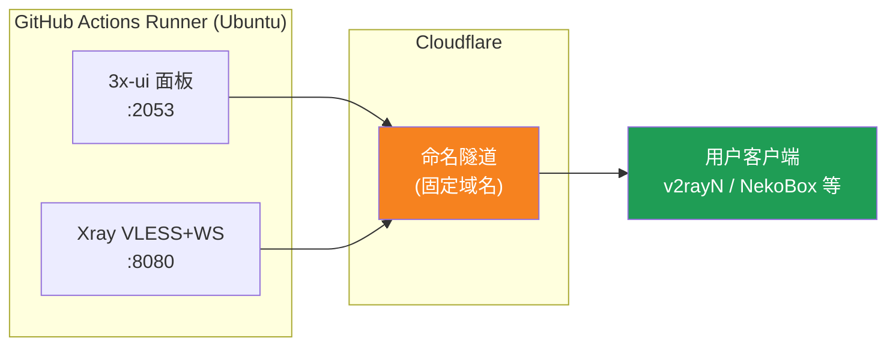
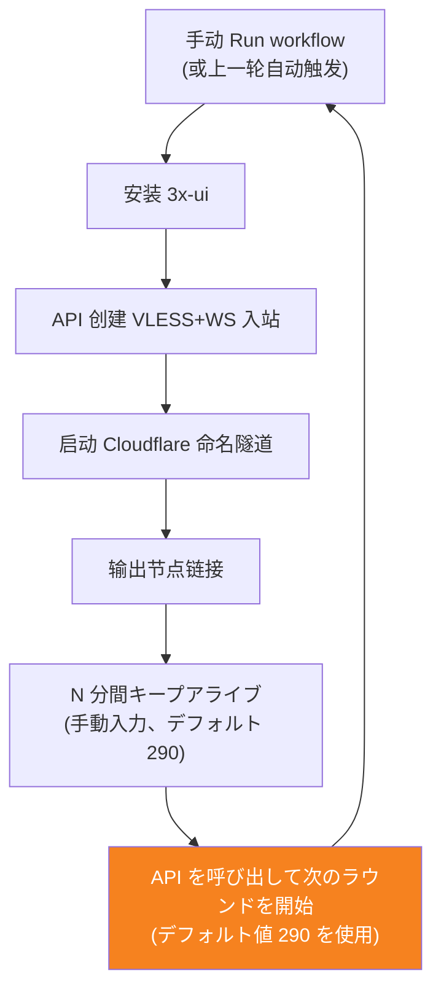
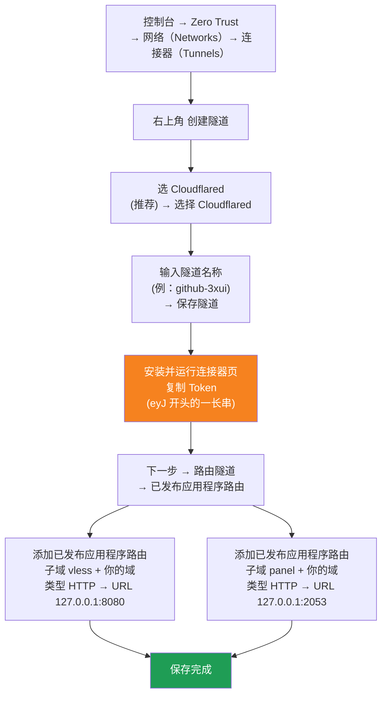

[简体中文](README.md) | [English](README.en.md) | [Русский](README.ru.md) | [日本語](README.ja.md) | [한국어](README.ko.md) | [Español](README.es.md) | [العربية](README.ar.md) | [Čeština](README.cs.md) | [Dansk](README.da.md) | [Deutsch](README.de.md) | [Esperanto](README.eo.md) | [فارسی](README.fa.md) | [Suomi](README.fi.md) | [Français](README.fr.md) | [Ελληνικά](README.gr.md) | [Magyar](README.hu.md) | [Bahasa Indonesia](README.id.md) | [Italiano](README.it.md) | [മലയാളം](README.ml.md) | [Nederlands](README.nl.md) | [Norsk](README.no.md) | [Polski](README.pl.md) | [Português](README.ptbr.md) | [Română](README.ro.md) | [Türkçe](README.tr.md) | [Українська](README.ua.md) | [Tiếng Việt](README.vn.md)

# ☁️ cloud-3xui — GitHub で作る無料 VLESS ノード

GitHub Actions の無料サーバーで 3x-ui パネル＋VLESS ノードを自動構築。固定ドメインで、切断時は自動で復旧します。

## アーキテクチャ



## 自動復旧フロー



## 自動復旧

- **キープアライブ時間は自分で指定**：Run workflow をクリックするときに `run_minutes` を手動で入力します。入力した分数だけ実行され、空欄のままならデフォルトの 290 を使います
- **自動トリガーはデフォルト値を使用**：各ラウンド終了時に API を呼び出して次のラウンドを開始します。API トリガーにはパラメータが付かないため、自動復旧の各ラウンドはすべて 290 分です
- 一時的なテストなら `5` と入力し、日常利用では空欄のままデフォルトの 290 で使います
- ドメインと UUID は固定なので、クライアントは一度設定すればずっと使えます
- 止めたいときは Actions で Cancel をクリックすれば、自動で再起動されることはありません


## 固定アドレス

| 用途 | アドレス |
|------|----------|
| ノード | `vless.my-github.ccwu.cc:443`（VLESS + WebSocket + TLS） |
| パネル | `https://panel.my-github.ccwu.cc/panel`（ユーザー名 `admin`） |

> ⚠️ 上記のドメインは例です。ご自身のドメインに置き換えてください。

## 詳細な設定手順

### ステップ1：Cloudflare で名前付きトンネルを作成


Cloudflare 公式サイト: https://www.cloudflare-cn.com （中国）/ https://www.cloudflare.com （国際版）
ダッシュボード: https://dash.cloudflare.com



詳細手順:

1. [Cloudflare Dashboard](https://dash.cloudflare.com) を開き、左メニューから **Zero Trust** → **Networks** → **Tunnels** に進む
2. 右上の **Create a tunnel** をクリック
3. **トンネルタイプの選択**: **Cloudflared**（推奨）を選び、**Select Cloudflared** をクリック
4. **トンネルに名前を付ける**: 名前（例: `github-3xui`）を入力し、**Save tunnel** をクリック
5. **コネクタのインストールと実行**: ページにインストールコマンドが表示されるので、`eyJ` で始まる長い **Token** をコピーして保存する（後で GitHub Secret に登録）。ローカルへのインストールは**不要**。そのまま次へ進む
6. **トンネルのルーティング**: **Public hostnames** タブを開き、**Add a public hostname** をクリックして 2 件追加する:

   **1 件目（ノード）:**
   - サブドメイン: `vless`
   - ドメイン: 自分のドメインを選択
   - タイプ: `HTTP`
   - URL: `127.0.0.1:8080`

   **2 件目（パネル）:**
   - サブドメイン: `panel`
   - ドメイン: 自分のドメインを選択
   - タイプ: `HTTP`
   - URL: `127.0.0.1:2053`
7. 保存する。DNS レコードは Cloudflare が自動作成する。Tunnels 一覧でステータスが **Healthy** になれば設定成功。


### ステップ2：UUID を生成

1. https://1024tools.com/uuid/ を開きます
2. 生成された UUID をコピーします（例：`cbfc229f-9d34-4fef-9990-8baa82a7327b`）
3. **この UUID は必ずメモしてください**。ワークフローのログには平文で表示されません。ノードリンクを組み立てるたびに必要になります

### ステップ3：GitHub に Secrets を追加

1. このリポジトリを開き、**Settings** タブをクリックします
2. 左側の **Secrets and variables** → **Actions** に入ります
3. 右上の **New repository secret** をクリックし、以下の3つを追加します：

   | Name | Secret（値） | 説明 |
   |------|-------------|------|
   | `CF_TUNNEL_TOKEN` | ステップ1でコピーした Tunnel Token | Cloudflare トンネルの認証情報 |
   | `PANEL_PASSWORD` | ご自身で設定したパネルパスワード | 3x-ui パネルのログインパスワード |
   | `VLESS_UUID` | ステップ2で生成した UUID | ノードの UUID、変更しません |

### ステップ4：ワークフローを実行

1. リポジトリ上部の **Actions** タブをクリックします
2. 左側で **3x-ui VLESS Node** を選択します
3. 右側の **Run workflow** ボタンをクリックします
4. 表示されたフォームで：
   - **Panel password**：空欄のまま（`PANEL_PASSWORD` secret を自動使用）
     パネルパスワード（空欄の場合は PANEL_PASSWORD secret を使用）
   - **Run duration**：デフォルト `290`（分）。初回テストでは `5` と入力して素早く確認できます。日常利用では空欄のままで構いません
     実行時間（分、デフォルト 290、最大 340）
5. 緑色の **Run workflow** をクリックして実行します

### ステップ5：ノードリンクを取得

1. 約2〜3分待ち、実行中のジョブをクリックして詳細ページを開きます
2. **Start named Cloudflare tunnel** ステップを展開し、ログ出力を確認します：
   ```
   ==================================================
     面板 Panel: https://panel.my-github.ccwu.cc/panel  (admin / 你的密码 your password)

     VLESS 节点 node:
     vless://YOUR_UUID@vless.my-github.ccwu.cc:443?encryption=none&security=tls&sni=vless.my-github.ccwu.cc&type=ws&path=%2Fws#GitHub-3xui

     把 YOUR_UUID 换成你在 VLESS_UUID secret 里填的 UUID
     Replace YOUR_UUID with the UUID from your VLESS_UUID secret
   ==================================================
   ```
3. `vless://` リンクをコピーし、`YOUR_UUID` をご自身の UUID に置き換えます
4. v2rayN / v2rayNG / Streisand / NekoBox などのクライアントに貼り付ければ使えます

### ステップ6：自動復旧の確認（任意）

1. 初回実行時は実行時間を `5` 分に設定します
2. 5分後、最後の **Trigger next run** ステップのログを確認します。以下のように表示されるはずです：
   ```
   HTTP 204
   已触发下一次运行 Next run triggered
   ```
3. Actions の一覧に戻ると、新しく自動トリガーされた実行が表示されます
4. 問題なければ、実行時間を `290` に戻して再実行し、通常利用します

## ワークフローのステップ説明

| ステップ | 中文 | English | 説明 |
|----------|------|---------|------|
| Install 3x-ui | 安装 3x-ui | Install 3x-ui | 公式スクリプトでパネルを非対話インストール |
| Create VLESS+WS inbound via API | 通过 API 创建 VLESS+WS 入站 | Create VLESS+WS inbound via API | API Token でログインし、インバウンドを自動作成 |
| Start named Cloudflare tunnel | 启动 Cloudflare 命名隧道 | Start named Cloudflare tunnel | Token で固定ドメインのトンネルに接続 |
| Keep alive | 保活 | Keep alive | 指定した分数スリープし、サービスの状態を監視 |
| Trigger next run | 触发下一次运行 | Trigger next run | API を呼び出して次のラウンドを自動起動 |

## よくある質問

**Q: ログ中のノードリンクの UUID が `***` と表示されるのは？**
A: GitHub の secret 保護機能によるものです。`YOUR_UUID` を、`VLESS_UUID` secret に設定したご自身の UUID に置き換えてください。

**Q: クライアントのテストが通らない（-1）のは？**
A: 3点を確認してください：① UUID が正しく置き換えられているか；② クライアントのバージョンが十分新しいか（v2rayN 7.x 以上）；③ Cloudflare トンネルが正常に接続されているか（ログを確認）。

**Q: 自動再起動がトリガーされないのは？**
A: **Trigger next run** ステップのログを確認してください。204 以外の HTTP ステータスコードが表示されている場合は、リポジトリの Actions 権限設定を確認してください。

**Q: 5時間ごとに数分切断されるのは正常ですか？**
A: 正常です。前のラウンド終了から次のラウンドのトンネル接続まで約3〜5分かかり、クライアントは自動で再接続します。

**Q: 自動復旧を止めたい場合は？**
A: Actions ページで現在の実行を Cancel するだけです。自動で再びトリガーされることはありません。

## 注意事項

- **速度**：トラフィックは Cloudflare → GitHub のデータセンター（米欧）を経由するため、一時的な利用・軽い利用にのみ適しています
- **一時的な中断**：5時間ごとの自動再起動の引き継ぎ時に約3〜5分中断します（新しいマシンの起動、3x-ui のインストール、トンネルの再接続）。クライアントは自動で再接続します
- **コンプライアンス**：GitHub Actions でプロキシを動かすのは ToS 違反でアカウント停止になるリスクがあります。ご自身で判断してください
- **セキュリティ**：`CF_TUNNEL_TOKEN` / `PANEL_PASSWORD` / `VLESS_UUID` を公開の場に載せないでください
