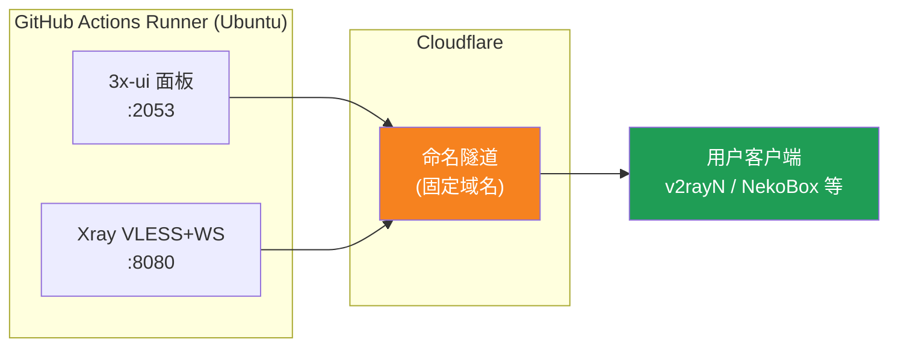
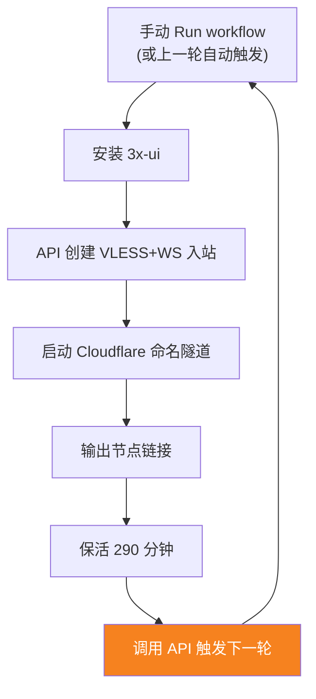

[简体中文](README.md) | [English](README.en.md) | [Русский](README.ru.md) | [日本語](README.ja.md) | [한국어](README.ko.md) | [Español](README.es.md) | [العربية](README.ar.md) | [Čeština](README.cs.md) | [Dansk](README.da.md) | [Deutsch](README.de.md) | [Esperanto](README.eo.md) | [فارسی](README.fa.md) | [Suomi](README.fi.md) | [Français](README.fr.md) | [Ελληνικά](README.gr.md) | [Magyar](README.hu.md) | [Bahasa Indonesia](README.id.md) | [Italiano](README.it.md) | [മലയാളം](README.ml.md) | [Nederlands](README.nl.md) | [Norsk](README.no.md) | [Polski](README.pl.md) | [Português](README.ptbr.md) | [Română](README.ro.md) | [Türkçe](README.tr.md) | [Українська](README.ua.md) | [Tiếng Việt](README.vn.md)

# ☁️ cloud-3xui — GitHub 免费 VLESS 节点

用 GitHub Actions 的免费服务器自动搭建 3x-ui 面板 + VLESS 节点，固定域名，断线自动续命。

## 架构图



## 自动续命流程



## 固定地址

| 用途 | 地址 |
|------|------|
| 节点 | `vless.my-github.ccwu.cc:443`（VLESS + WebSocket + TLS） |
| 面板 | `https://panel.my-github.ccwu.cc/panel`（用户名 `admin`） |

> ⚠️ 上面的域名是示例，换成你自己的域名。

## 详细配置步骤

### 第一步：Cloudflare 创建命名隧道

1. 打开 [Cloudflare Dashboard](https://dash.cloudflare.com)，左侧菜单进入 **Zero Trust**
2. 左侧 **Networks** → **Tunnels**，点击右上角 **Create a tunnel**
3. 选择 **Cloudflared** 类型，点击下一步
4. 给隧道起个名字（例如 `github-3xui`），保存
5. 页面会显示一条安装命令，形如：
   ```
   cloudflared.exe service install eyJhIjoiYzEyNGI2...
   ```
   复制其中 `eyJ` 开头的一长串字符，这就是 **Tunnel Token**，保存好
6. 点击下一步进入 **Public hostnames**（已发布应用程序路由），点击 **Add a public hostname** 添加两条：

   **第一条（节点）：**
   - Subdomain（子域）：`vless`
   - Domain（域名）：选择你的域名
   - Service Type（服务类型）：`HTTP`
   - URL：`127.0.0.1:8080`

   **第二条（面板）：**
   - Subdomain（子域）：`panel`
   - Domain（域名）：选择你的域名
   - Service Type（服务类型）：`HTTP`
   - URL：`127.0.0.1:2053`

7. 保存。Cloudflare 会自动创建 DNS 解析，无需手动添加。

### 第二步：生成 UUID

1. 打开 https://1024tools.com/uuid/
2. 复制生成的 UUID（形如 `cbfc229f-9d34-4fef-9990-8baa82a7327b`）
3. **务必记好这个 UUID**，工作流日志里不会明文显示，每次拼接节点链接都要用它

### 第三步：GitHub 添加 Secrets

1. 进入本仓库，点击 **Settings** 标签页
2. 左侧 **Secrets and variables** → **Actions**
3. 点击右上角 **New repository secret**，依次添加三个：

   | Name | Secret（值） | 说明 |
   |------|-------------|------|
   | `CF_TUNNEL_TOKEN` | 第一步复制的 Tunnel Token | Cloudflare 隧道凭证 |
   | `PANEL_PASSWORD` | 你设定的面板密码 | 3x-ui 面板登录密码 |
   | `VLESS_UUID` | 第二步生成的 UUID | 节点 UUID，固定不变 |

### 第四步：运行工作流

1. 点击仓库顶部的 **Actions** 标签页
2. 左侧选择 **3x-ui VLESS Node**
3. 点击右侧 **Run workflow** 按钮
4. 在弹出的表单中：
   - **Panel password**：留空（自动使用 `PANEL_PASSWORD` secret）
     面板密码（留空则使用 PANEL_PASSWORD secret）
   - **Run duration**：默认 `290`（分钟），首次测试可填 `5` 快速验证；日常使用留空即可
     运行时长（分钟，默认 290，最多 340）
5. 点击绿色的 **Run workflow** 开始运行

### 第五步：获取节点链接

1. 等待约 2-3 分钟，点击正在运行的任务进入详情页
2. 展开 **Start named Cloudflare tunnel** 步骤，查看日志输出：
   ```
   ==================================================
     面板 Panel: https://panel.my-github.ccwu.cc/panel  (admin / 你的密码 your password)

     VLESS 节点 node:
     vless://YOUR_UUID@vless.my-github.ccwu.cc:443?encryption=none&security=tls&sni=vless.my-github.ccwu.cc&type=ws&path=%2Fws#GitHub-3xui

     把 YOUR_UUID 换成你在 VLESS_UUID secret 里填的 UUID
     Replace YOUR_UUID with the UUID from your VLESS_UUID secret
   ==================================================
   ```
3. 复制 `vless://` 链接，把 `YOUR_UUID` 替换成你的 UUID
4. 粘贴到 v2rayN / v2rayNG / Streisand / NekoBox 等客户端即可使用

### 第六步：验证自动续命（可选）

1. 首次运行时把时长设为 `5` 分钟
2. 5 分钟后查看最后一步 **Trigger next run** 的日志，应显示：
   ```
   HTTP 204
   已触发下一次运行 Next run triggered
   ```
3. 回到 Actions 列表，应出现一个新的自动触发的运行
4. 确认无误后，重新运行并把时长改回 `290` 正常使用

## 工作流步骤说明

| 步骤 | 中文 | English | 说明 |
|------|------|---------|------|
| Install 3x-ui | 安装 3x-ui | Install 3x-ui | 用官方脚本非交互安装面板 |
| Create VLESS+WS inbound via API | 通过 API 创建 VLESS+WS 入站 | Create VLESS+WS inbound via API | 用 API Token 登录，自动建入站 |
| Start named Cloudflare tunnel | 启动 Cloudflare 命名隧道 | Start named Cloudflare tunnel | 用 Token 连接固定域名隧道 |
| Keep alive | 保活 | Keep alive | 休眠指定分钟数，监控服务状态 |
| Trigger next run | 触发下一次运行 | Trigger next run | 调用 API 自动拉起下一轮 |

## 常见问题

**Q: 日志里节点链接的 UUID 显示为 `***`？**
A: 这是 GitHub 的 secret 保护机制。用你自己在 `VLESS_UUID` secret 里填的 UUID 替换掉 `YOUR_UUID` 即可。

**Q: 客户端测试不通（-1）？**
A: 检查三点：① UUID 是否替换正确；② 客户端版本是否较新（v2rayN 7.x+）；③ Cloudflare 隧道是否正常连接（看日志）。

**Q: 自动重启没有触发？**
A: 查看 **Trigger next run** 步骤的日志。如果显示非 204 的 HTTP 状态码，检查仓库的 Actions 权限设置。

**Q: 每 5 小时断线几分钟正常吗？**
A: 正常。上一轮结束到下一轮隧道连上约需 3-5 分钟，客户端会自动重连。

**Q: 想停止自动续命？**
A: 去 Actions 页面 Cancel 掉当前运行即可，不会自动再触发。

## 注意事项

- **速度**：流量经 Cloudflare → GitHub 机房（美欧），仅适合临时/轻度使用
- **短暂中断**：每 5 小时自动重启交接时约断 3-5 分钟（新机器启动、装 3x-ui、隧道重连），客户端会自动重连恢复
- **合规**：在 GitHub Actions 跑代理有违反 ToS 被封号的风险，自行评估
- **安全**：不要把 `CF_TUNNEL_TOKEN` / `PANEL_PASSWORD` / `VLESS_UUID` 发到公开地方
