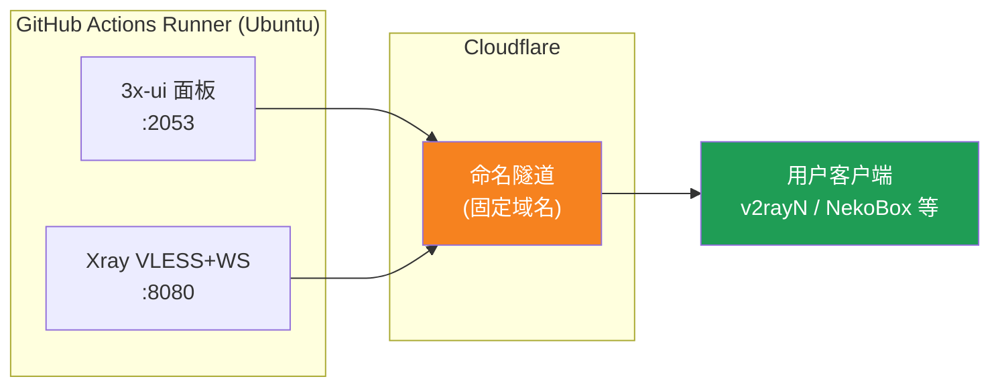
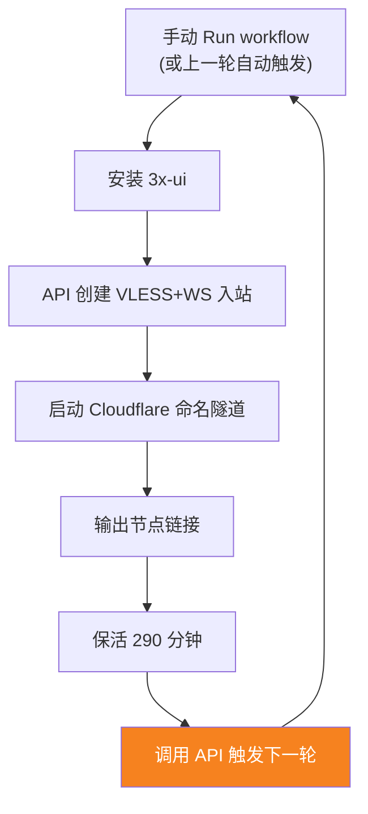

[简体中文](README.md) | [English](README.en.md) | [Русский](README.ru.md) | [日本語](README.ja.md) | [한국어](README.ko.md) | [Español](README.es.md) | [العربية](README.ar.md) | [Čeština](README.cs.md) | [Dansk](README.da.md) | [Deutsch](README.de.md) | [Esperanto](README.eo.md) | [فارسی](README.fa.md) | [Suomi](README.fi.md) | [Français](README.fr.md) | [Ελληνικά](README.gr.md) | [Magyar](README.hu.md) | [Bahasa Indonesia](README.id.md) | [Italiano](README.it.md) | [മലയാളം](README.ml.md) | [Nederlands](README.nl.md) | [Norsk](README.no.md) | [Polski](README.pl.md) | [Português](README.ptbr.md) | [Română](README.ro.md) | [Türkçe](README.tr.md) | [Українська](README.ua.md) | [Tiếng Việt](README.vn.md)

# ☁️ cloud-3xui — Node VLESS Miễn Phí trên GitHub

Tự động dựng bảng điều khiển 3x-ui + node VLESS trên máy chủ miễn phí của GitHub Actions, tên miền cố định, tự động gia hạn khi đứt kết nối.

## Sơ Đồ Kiến Trúc



## Quy Trình Tự Động Gia Hạn



## Địa Chỉ Cố Định

| Mục đích | Địa chỉ |
|------|------|
| Node | `vless.my-github.ccwu.cc:443`（VLESS + WebSocket + TLS） |
| Bảng điều khiển | `https://panel.my-github.ccwu.cc/panel`（tên đăng nhập `admin`） |

> ⚠️ Các tên miền ở trên chỉ là ví dụ, hãy thay bằng tên miền của bạn.

## Các Bước Cấu Hình Chi Tiết

### Bước 1: Tạo Named Tunnel trong Cloudflare

1. Mở [Cloudflare Dashboard](https://dash.cloudflare.com), vào menu bên trái **Zero Trust**
2. Bên trái **Networks** → **Tunnels**, nhấn **Create a tunnel** ở góc trên bên phải
3. Chọn loại **Cloudflared**, nhấn tiếp theo
4. Đặt tên cho tunnel (ví dụ `github-3xui`), lưu lại
5. Trang sẽ hiển thị một lệnh cài đặt, dạng như:
   ```
   cloudflared.exe service install eyJhIjoiYzEyNGI2...
   ```
   Sao chép chuỗi ký tự dài bắt đầu bằng `eyJ`, đó chính là **Tunnel Token**, lưu lại cẩn thận
6. Nhấn tiếp theo để vào **Public hostnames** (Định tuyến ứng dụng công khai), nhấn **Add a public hostname** để thêm hai cái:

   **Cái thứ nhất (node):**
   - Subdomain (tên miền phụ): `vless`
   - Domain (tên miền): chọn tên miền của bạn
   - Service Type (loại dịch vụ): `HTTP`
   - URL: `127.0.0.1:8080`

   **Cái thứ hai (bảng điều khiển):**
   - Subdomain (tên miền phụ): `panel`
   - Domain (tên miền): chọn tên miền của bạn
   - Service Type (loại dịch vụ): `HTTP`
   - URL: `127.0.0.1:2053`

7. Lưu lại. Cloudflare sẽ tự động tạo bản ghi DNS, không cần thêm thủ công.

### Bước 2: Tạo UUID

1. Mở https://1024tools.com/uuid/
2. Sao chép UUID được tạo (dạng như `cbfc229f-9d34-4fef-9990-8baa82a7327b`)
3. **Hãy ghi nhớ UUID này**, nhật ký workflow sẽ không hiển thị nó dưới dạng văn bản thuần, mỗi lần ghép liên kết node đều cần dùng đến nó

### Bước 3: Thêm Secrets vào GitHub

1. Vào kho này, nhấn tab **Settings**
2. Bên trái **Secrets and variables** → **Actions**
3. Nhấn **New repository secret** ở góc trên bên phải, lần lượt thêm ba cái:

   | Name | Secret (giá trị) | Giải thích |
   |------|-------------|------|
   | `CF_TUNNEL_TOKEN` | Tunnel Token đã sao chép ở bước 1 | Thông tin xác thực tunnel Cloudflare |
   | `PANEL_PASSWORD` | Mật khẩu bảng điều khiển bạn đặt | Mật khẩu đăng nhập bảng 3x-ui |
   | `VLESS_UUID` | UUID đã tạo ở bước 2 | UUID của node, cố định không đổi |

### Bước 4: Chạy Workflow

1. Nhấn tab **Actions** ở đầu kho
2. Bên trái chọn **3x-ui VLESS Node**
3. Nhấn nút **Run workflow** bên phải
4. Trong biểu mẫu hiện ra:
   - **Panel password**: để trống (tự động dùng secret `PANEL_PASSWORD`)
     Mật khẩu bảng điều khiển (để trống sẽ dùng secret PANEL_PASSWORD)
   - **Run duration**: mặc định `290` (phút), lần đầu kiểm tra có thể điền `5` để xác minh nhanh
     Thời gian chạy (phút, mặc định 290, tối đa 340)
5. Nhấn nút **Run workflow** màu xanh để bắt đầu chạy

### Bước 5: Lấy Liên Kết Node

1. Đợi khoảng 2-3 phút, nhấn vào tác vụ đang chạy để vào trang chi tiết
2. Mở rộng bước **Start named Cloudflare tunnel**, xem đầu ra nhật ký:
   ```
   ==================================================
     面板 Panel: https://panel.my-github.ccwu.cc/panel  (admin / 你的密码 your password)

     VLESS 节点 node:
     vless://YOUR_UUID@vless.my-github.ccwu.cc:443?encryption=none&security=tls&sni=vless.my-github.ccwu.cc&type=ws&path=%2Fws#GitHub-3xui

     把 YOUR_UUID 换成你在 VLESS_UUID secret 里填的 UUID
     Replace YOUR_UUID with the UUID from your VLESS_UUID secret
   ==================================================
   ```
3. Sao chép liên kết `vless://`, thay `YOUR_UUID` bằng UUID của bạn
4. Dán vào các ứng dụng khách như v2rayN / v2rayNG / Streisand / NekoBox là dùng được

### Bước 6: Xác Minh Tự Động Gia Hạn (tùy chọn)

1. Lần chạy đầu tiên đặt thời gian là `5` phút
2. Sau 5 phút xem nhật ký bước cuối **Trigger next run**, sẽ hiển thị:
   ```
   HTTP 204
   已触发下一次运行 Next run triggered
   ```
3. Quay lại danh sách Actions, sẽ xuất hiện một lần chạy mới được kích hoạt tự động
4. Sau khi xác nhận không có vấn đề, chạy lại và đổi thời gian về `290` để sử dụng bình thường

## Giải Thích Các Bước Workflow

| Bước | Tiếng Việt | English | Giải thích |
|------|------------|---------|------|
| Install 3x-ui | Cài đặt 3x-ui | Install 3x-ui | Cài đặt bảng điều khiển bằng script chính thức, không tương tác |
| Create VLESS+WS inbound via API | Tạo inbound VLESS+WS qua API | Create VLESS+WS inbound via API | Đăng nhập bằng API Token, tự động tạo inbound |
| Start named Cloudflare tunnel | Khởi động Named Tunnel Cloudflare | Start named Cloudflare tunnel | Kết nối tunnel tên miền cố định bằng Token |
| Keep alive | Giữ hoạt động | Keep alive | Ngủ số phút chỉ định, giám sát trạng thái dịch vụ |
| Trigger next run | Kích hoạt lần chạy tiếp theo | Trigger next run | Gọi API để tự động khởi động vòng tiếp theo |

## Câu Hỏi Thường Gặp

**H: UUID trong liên kết node ở nhật ký hiển thị `***`?**
Đ: Đây là cơ chế bảo vệ secret của GitHub. Chỉ cần thay `YOUR_UUID` bằng UUID bạn đã điền trong secret `VLESS_UUID`.

**H: Ứng dụng khách kiểm tra không thông (-1)?**
Đ: Kiểm tra ba điểm: ① UUID đã thay đúng chưa; ② phiên bản ứng dụng khách có mới không (v2rayN 7.x+); ③ tunnel Cloudflare có kết nối bình thường không (xem nhật ký).

**H: Tự động khởi động lại không được kích hoạt?**
Đ: Xem nhật ký bước **Trigger next run**. Nếu hiển thị mã trạng thái HTTP khác 204, hãy kiểm tra cài đặt quyền Actions của kho.

**H: Đứt kết nối vài phút mỗi 5 giờ có bình thường không?**
Đ: Bình thường. Từ khi vòng trước kết thúc đến khi tunnel của vòng tiếp theo kết nối mất khoảng 3-5 phút, ứng dụng khách sẽ tự động kết nối lại.

**H: Muốn dừng tự động gia hạn?**
Đ: Vào trang Actions, Cancel lần chạy hiện tại là được, sẽ không tự động kích hoạt nữa.

## Lưu Ý

- **Tốc độ**: Lưu lượng đi qua Cloudflare → máy chủ GitHub (Mỹ/Châu Âu), chỉ phù hợp dùng tạm thời/nhẹ
- **Gián đoạn ngắn**: Mỗi 5 giờ khi tự động khởi động lại chuyển giao, đứt khoảng 3-5 phút (khởi động máy mới, cài 3x-ui, kết nối lại tunnel), ứng dụng khách sẽ tự động kết nối lại
- **Tuân thủ**: Chạy proxy trên GitHub Actions có nguy cơ vi phạm ToS bị khóa tài khoản, tự đánh giá
- **Bảo mật**: Đừng đăng `CF_TUNNEL_TOKEN` / `PANEL_PASSWORD` / `VLESS_UUID` ở nơi công khai
